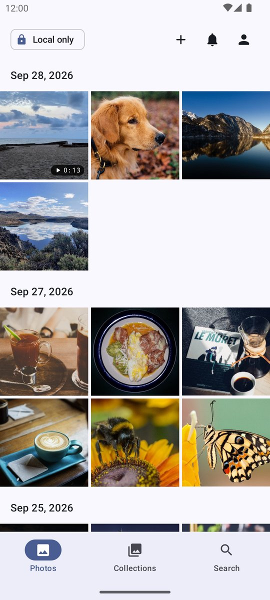
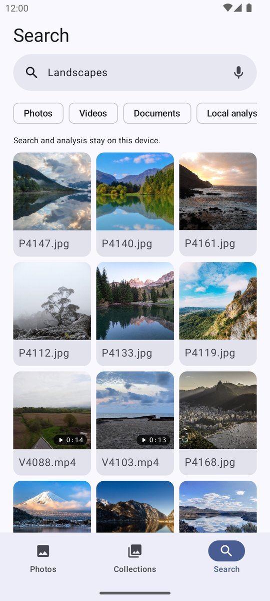
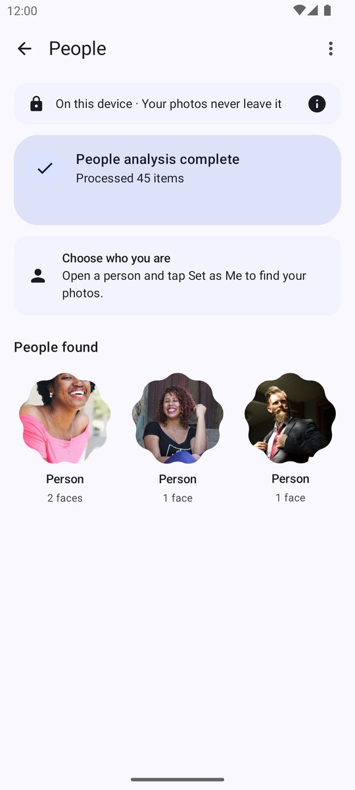
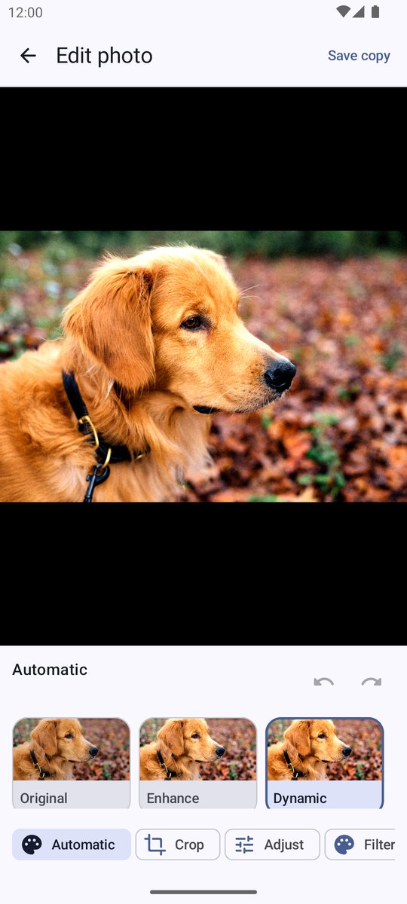
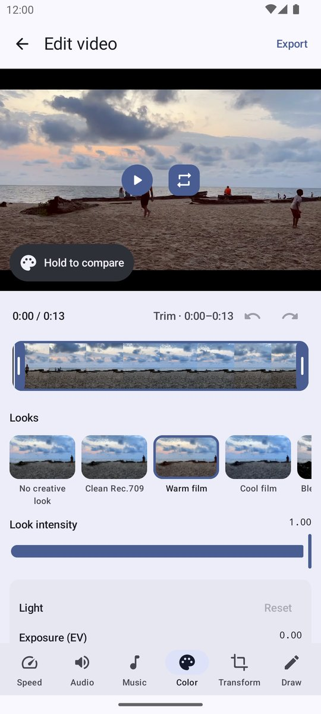
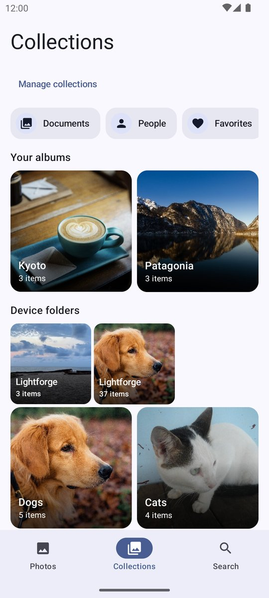
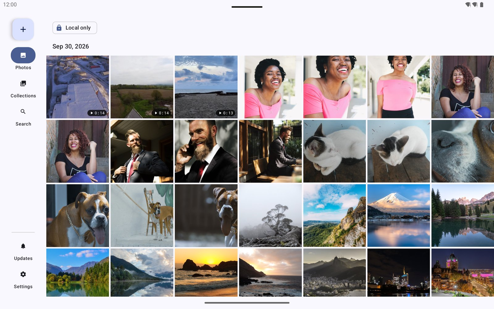

# Lightforge

Lightforge Studio is a native, open-source gallery for Android, built for local libraries of 100,000 to 250,000 photos and videos. MediaStore is the single source of truth; Room, AppSearch, thumbnails and every ML index are caches that can be rebuilt. Organization, search and recognition run on the device, and nothing is presented as working until it does: unfinished paths degrade with an explicit label instead of a silent stub.

- **Version:** `0.8.0-beta` (public beta)
- **Package:** `com.librestatic.lightforge`
- **Requires:** Android 11 (API 30) or later
- **License:** [Apache-2.0](LICENSE)
- **Languages:** English, Spanish, French, Portuguese, Italian and German

## Screenshots

| Timeline | Search | People |
|---|---|---|
|  |  |  |
| **Photo editor** | **Video editor** | **Collections** |
|  |  |  |



Sample media is CC0 / public domain; see [`store/play/raw/MEDIA_LICENSES.md`](store/play/raw/MEDIA_LICENSES.md).

## Features

### Library and browsing

- Timeline grid with pinch-to-zoom that keeps its anchor across rotation, resize and fold changes; built for 250k items without ANR or OOM.
- Incremental sync through ContentObserver, MediaStore generations and per-volume reconciliation, including removable SD cards; no full scan at startup.
- Full, selected-media and revoked photo permission states, revalidated on every return to the foreground. All files access is never required; it only backs the opt-in advanced storage mode.
- Full-screen viewer with large-image tiling, animated GIF/WebP, Media3 video playback, motion photos (Samsung and Google formats) and lazy EXIF details. Press and hold a video for AI slow motion with frame interpolation (GPU, or the DSP (HVX) where available) and save the clip.
- Bottom tabs for Photos, Collections and Search, plus a Create menu (album, memory, memory video, GIF, collage, PDF, recoveries) and an Updates screen for local activity and video exports.
- On device folder explorer: pin, exclude, cover, home screen shortcuts and single-folder chain merging; with the opt-in advanced storage mode, also hidden `.nomedia` folders, hide by name and folder create, rename, move, copy and delete.
- Albums (physical and virtual), favorites, smart albums, photo stacks, Documents, Archive and Trash, with bounded bulk actions in chunks of up to 500 items.

### Search and organization

- Keyword search (AppSearch), plus search by date, place, people, pets and text in photos (OCR).
- Optional semantic search with signed, user-managed TinyCLIP model packages; keyword search stays available without one.
- Opt-in face grouping with conservative clustering and manual correction, dog and cat collections plus optional individual pet recognition, bundled offline reverse geocoding for place names, and an offline Places map from user-imported PMTiles/MBTiles packages.
- Exact duplicates, large videos, screenshots and blurry photos to review in Free up space, similar-photo stack suggestions, and memories grouped by time and place.

### Editing and creation

- Photo editor with filters, crop, straighten, adjustments and Camera RAW development. Object eraser and subject cut-out are labelled experimental.
- Video editor with trim, speed, slow-motion segments with frame interpolation, music, color, LOG footage, LUT import, drawing with object tracking, and HDR export where the device supports it; exports run in a background queue.
- PDF Studio, collage, GIF maker, memory videos and a home screen widget.
- Edits are saved as copies by default; overwriting an original goes through the system authorization flow.

### Appearance

- Material You dynamic color (Android 12+) or fixed themes (Neutral, Rounded, Crisp, Warm, Minimalist Black), light/dark/system mode, pure black (AMOLED), and an in-app language choice.

### Privacy and sharing

- Encrypted private album (AES-256-GCM, Android Keystore, biometric gate, `FLAG_SECURE`) with password-protected encrypted backup.
- App lock with relock timeout, optional authentication for destructive actions and, with advanced storage mode, protection of hidden items.
- Encrypted transfer of originals to another Android device on the local network.
- Backup to the user's own SFTP or SMB server: one verified backup archive of selected originals, with optional organization.
- Folder synchronization (OwnSync): copies one chosen local folder to the user's own SFTP or SMB server, additive or managed mirror, reviewed before applying, never overwriting or deleting on the server.
- Local file backup to the device or a USB drive, with verified restore.
- Settings and favorites export and import, with per-category review.

## Principles

- Local first: no accounts, ads, analytics, telemetry or cloud dependency. Gallery data, queries and embeddings never leave the device.
- MediaStore is the authority; identity is `(volumeName, mediaStoreId)`, never an absolute path.
- Permission states are first-class: full, partial and revoked all work explicitly.
- All writes are atomic or recoverable (`IS_PENDING` exports, size and SHA-256 verification before publishing).
- Honesty over illusion: no misleading stubs, no hidden errors, no invented success.

See the [privacy policy](store/play/privacy-policy.md) and the [commercial use audit](docs/legal/COMMERCIAL_USE_AUDIT.md) for details.

## Permissions

| Permission | Used for |
|---|---|
| `READ_MEDIA_IMAGES`, `READ_MEDIA_VIDEO`, `READ_MEDIA_VISUAL_USER_SELECTED`, `READ_EXTERNAL_STORAGE` (API 30–32) | Reading the library, with full or selected-media access. |
| `ACCESS_MEDIA_LOCATION` | Photo locations for Places and details; suppressed when access is not granted and purged on revoke. |
| `INTERNET`, `ACCESS_NETWORK_STATE`, `ACCESS_LOCAL_NETWORK` | User-initiated model downloads, backup to the user's own servers and local-network sharing only. Guarded by `tools/verify_offline_release.py`; cleartext traffic is disabled. |
| `POST_NOTIFICATIONS`, `FOREGROUND_SERVICE`, `FOREGROUND_SERVICE_DATA_SYNC`, `FOREGROUND_SERVICE_MEDIA_PROCESSING` | Visible progress for long exports, indexing, backup and transfers. |

`MANAGE_MEDIA` (optional, Android 12+) lets batch edits, trash and deletes skip the per-batch confirmation. `MANAGE_EXTERNAL_STORAGE` backs an opt-in advanced storage mode (hidden `.nomedia` folders, in-place moves, folder operations); it lives only in `:core:storage-advanced` and `-Plightforge.allFilesAccess=false` strips it from the build (ADR-046). No location permission and no OEM privilege assumptions; Wi-Fi and location permissions pulled in by libraries are removed from the merged manifest.

## Project status

Milestones M0 through M6 are complete: library engine and timeline, management and viewer, search and similarity, people, pets and moments, editors and private sharing, and the advanced isolated features.

Still open:

- **Object eraser** is still experimental: it fills with the MI-GAN inpainting model (14 MB, downloaded on demand, GPU when available) and falls back to neighbor interpolation without it. A larger generative model (Moebius) is wired in, but its package is not published yet.
- **Subject cut-out** uses an explicit color-distance fallback until an ML model is added.
- **Physical-device passes** for the latest design, fold-posture and private-album wiring are still pending; emulator evidence covers them for now.
- **Exact pixel parity** with the design mockup is not claimed.

## Repository layout

| Path | Contents |
|---|---|
| `app/` | Application shell, navigation host, DI and manifest. |
| `core/` | Shared modules: data, database (Room), MediaStore, thumbnails, search, ML, selection, editing, RAW, security, design system and more. |
| `feature/` | One module per surface: photos, collections, viewer, search, editors, private album, PDF Studio, places, sharing, backup and more. |
| `benchmark/`, `baselineprofile/` | Macrobenchmark journeys and Baseline Profile generation. |
| `testdata/`, `scripts/` | Synthetic 1k–250k library generation and helper scripts. |
| `tools/` | Release guards, license generation and verification scripts. |
| `docs/` | User guide, flow documentation, ADRs, architecture, design, legal and privacy. |
| `store/play/` | Google Play listings, images and check scripts. |

Documentation hierarchy: [PRODUCT.md](PRODUCT.md) → [ADRs](docs/adr/) → [Architecture](docs/architecture/README.md) → [Flow documentation](docs/flows/README.md) → code and tests. For end users, see the [User guide](docs/USER_GUIDE.md).

## Building and testing

Use JDK 17 and the checked-in Gradle wrapper:

```bash
./gradlew :app:assembleOfflineDebug :app:assembleOfflineRelease test lint
```

CI (`.github/workflows/android.yml`) runs that build plus `:app:compileOfflineDebugAndroidTestKotlin`, then the release guard against the merged manifest. A second job builds with advanced storage mode compiled out:

```bash
python tools/verify_offline_release.py --expect-all-files   # default build: MANAGE_EXTERNAL_STORAGE must be declared
./gradlew -Plightforge.allFilesAccess=false :app:assembleOfflineRelease test
python tools/verify_offline_release.py --no-all-files       # stripped build: it must not be declared
```

Instrumented tests need a device or emulator:

```bash
./gradlew :app:connectedOfflineDebugAndroidTest
```

For Compose UI work, `scripts/compose-driver.sh` renders debug previews headlessly with a semantics tree and screenshots; see [`tools/compose-driver/README.md`](tools/compose-driver/README.md).

The `offline` flavor is the shipped product; `demo` installs side by side with a `.demo` suffix. Debug builds use a `.debug` suffix so they never replace a normal install.

## Releases

- **GitHub:** every push to `main` (`.github/workflows/release.yml`) runs `test lint :app:bundleOfflineRelease :app:assembleOfflineRelease`, the release guard and a signature check, then publishes a prerelease tagged `v<versionName>+<versionCode>` with the App Bundle, APK, R8 mapping file and `SHA256SUMS.txt`.
- **Google Play:** the same offline release bundle is published through the Play Developer API with `tools/play-publish.py`. `status` lists every track; `publish --aab <aab> --mapping <mapping.txt>` uploads the bundle and mapping and releases it on a track (default `--track alpha`, the closed track) with notes from `store/play/release-notes/<versionName>.txt`. Run `--dry-run` first; `--no-review` commits without sending for review, and `--draft` (paired with `--no-review`) adds the release as a draft without validation, for releases that use a new permission Play Console must see before it accepts the declaration. GitHub and Play ship the same feature set ([ADR-044](docs/adr/ADR-044-commercial-distribution-scope.md)).

`versionCode` comes from the CI run number plus an offset, so it always increases. Signing uses the `LIGHTFORGE_KEYSTORE_*` and `LIGHTFORGE_KEY_*` environment variables; keys never enter the repository. The Apache-2.0 license grants no rights to the Lightforge name or icon.

## Contributing

Issues and pull requests are welcome at [LibreStatic/lightforge](https://github.com/LibreStatic/lightforge). Run the checks above before opening a pull request, keep new strings localized in every supported language, and back device claims with evidence.
