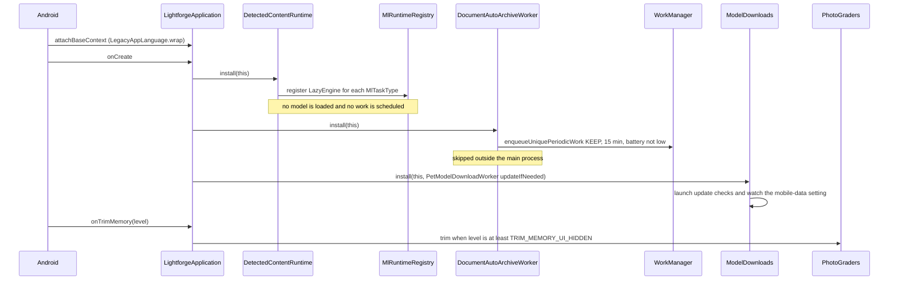
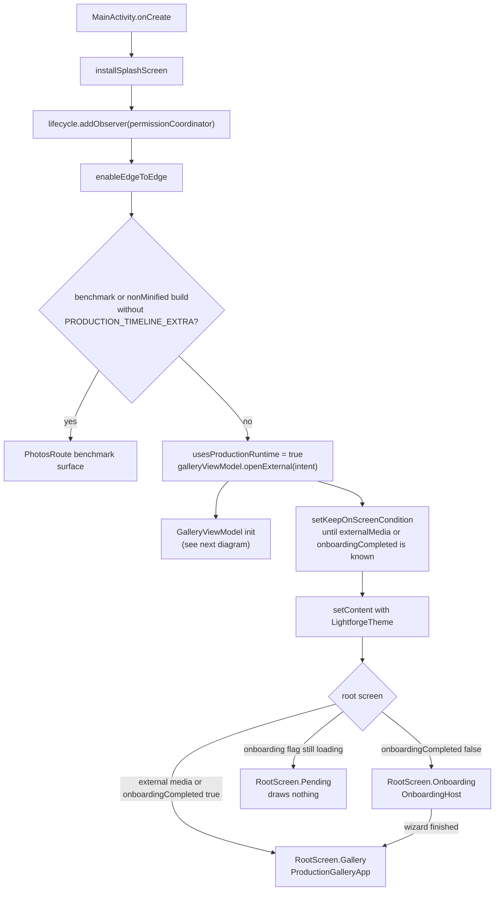
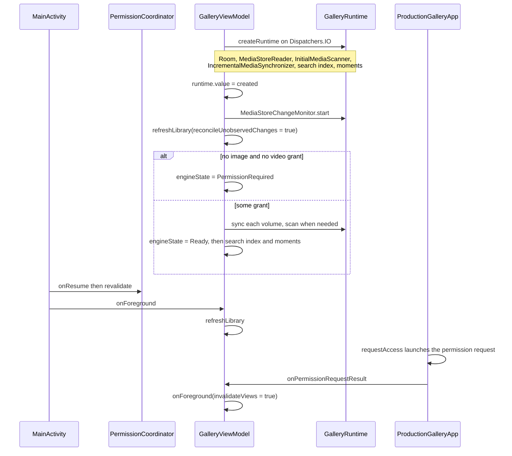

# App startup

This document follows a cold start of Lightforge from process creation to the first usable timeline. It covers the process-level setup in `LightforgeApplication` (ML engine registration, periodic document archiving, model update checks, memory trimming), `MainActivity.onCreate` and its splash handoff, the choice between onboarding and `ProductionGalleryApp`, the media permission check, and the moment the library runtime is created and decides between an initial scan and an incremental sync (detailed in [Library sync](library-sync.md)).

## Where it lives

- [LightforgeApplication.kt](../../app/src/main/kotlin/com/librestatic/lightforge/LightforgeApplication.kt): `LightforgeApplication` (`@HiltAndroidApp`), `attachBaseContext`, `onCreate`, `onTrimMemory`.
- [DetectedContentRuntime.kt](../../core/ml/src/main/kotlin/com/librestatic/lightforge/core/ml/DetectedContentRuntime.kt): `DetectedContentRuntime.install`, `LazyEngine`.
- [MlTask.kt](../../core/ml/src/main/kotlin/com/librestatic/lightforge/core/ml/MlTask.kt): `MlTaskType`, `MlTaskEngine`, `MlRuntimeRegistry.register`.
- [MlChunkWorker.kt](../../core/ml/src/main/kotlin/com/librestatic/lightforge/core/ml/MlChunkWorker.kt): `MlRuntimeRegistry.engine(task) ?: Result.retry()`.
- [DocumentAutoArchiveWorker.kt](../../app/src/main/kotlin/com/librestatic/lightforge/DocumentAutoArchiveWorker.kt): `DocumentAutoArchiveWorker.install`, `WorkName`.
- [ModelDownloads.kt](../../core/ml/src/main/kotlin/com/librestatic/lightforge/core/ml/ModelDownloads.kt): `ModelDownloads.install`, `reschedule`.
- [PetModelDownloadWorker.kt](../../feature/petrecognition/src/main/kotlin/com/librestatic/lightforge/feature/petrecognition/PetModelDownloadWorker.kt): `updateIfNeeded`.
- [GpuPhotoGrader.kt](../../core/editing-image/src/main/kotlin/com/librestatic/lightforge/core/editing/image/grade/GpuPhotoGrader.kt): `PhotoGraders.trim`.
- [MainActivity.kt](../../app/src/main/kotlin/com/librestatic/lightforge/MainActivity.kt): `MainActivity.onCreate`, `onResume`, `onStop`, `onNewIntent`, `RootScreen`, `LibraryEngineState.toUiState`.
- [PermissionCoordinator.kt](../../feature/permissions/src/main/kotlin/com/librestatic/lightforge/feature/permissions/PermissionCoordinator.kt): `PermissionCoordinator.onResume`, `revalidate`, `access`, `initialMediaRequest`, `reselectionRequest`.
- [ProductionGalleryApp.kt](../../app/src/main/kotlin/com/librestatic/lightforge/ProductionGalleryApp.kt): `ProductionGalleryApp`, `permissionLauncher`, `requestAccess`.
- [OnboardingHost.kt](../../app/src/main/kotlin/com/librestatic/lightforge/OnboardingHost.kt): `OnboardingHost`.
- [GalleryViewModel.kt](../../app/src/main/kotlin/com/librestatic/lightforge/GalleryViewModel.kt): `LibraryEngineState`, `init`, `createRuntime`, `onForeground`, `onBackground`, `onPermissionRequestResult`, `refreshLibrary`.

## Process start

1. `attachBaseContext` wraps the context with the per-app language on older Android versions, so workers and notifications started later use it.
2. `DetectedContentRuntime.install` is idempotent (`@Synchronized`, returns if already installed). It registers one `LazyEngine` per task: `ImageLabels`, `Ocr`, `ExactDuplicates`, `Similarity`, `FaceDetection`, `FaceEmbeddings`, `PersonClustering`. A `LazyEngine` checks permissions and purges derived data without loading a model; the real engine is resolved on the first `process` call.
3. `DocumentAutoArchiveWorker.install` enqueues the unique periodic `document-auto-archive` work with `ExistingPeriodicWorkPolicy.KEEP`.
4. `ModelDownloads.install` runs each feature's update check on its own IO scope and reschedules queued downloads whenever `modelDownloadsOnMobileData` changes.
5. `onTrimMemory` releases the photo editor's GL context through `PhotoGraders.trim` once the UI is hidden; it is rebuilt on demand.

## Activity and first composition

1. The system splash stays up until the first screen is known; on a cold start `setOnExitAnimationListener` hands the icon bounds to the onboarding wizard (`OnboardingSplashHandoff`). A recreated activity skips the handoff.
2. In production builds the first touch of `galleryViewModel` (`openExternal`) creates the `@HiltViewModel` and runs its `init`, so the library runtime starts in parallel with the first composition, even while onboarding is showing.
3. External `ACTION_VIEW`/`ACTION_EDIT` intents go straight to the gallery surface; a replayed folder shortcut (`ACTION_OPEN_FOLDER` with saved state) is ignored.
4. `onResume` calls `galleryViewModel.onForeground()`, `onStop` calls `onBackground()`, and `onNewIntent` forwards new intents to `openExternal`.

## Library runtime, permission check and first sync

1. `LibraryEngineState` starts at `Starting`. If `createRuntime` throws, it becomes `Error` and pending restorations are dropped.
2. The first `refreshLibrary` uses `reconcileUnobservedChanges = true`, so removals that happened while the process was dead are not missed. Per volume, `IncrementalMediaSynchronizer.sync` returns `NeedsInitialScan` on a first run (no checkpoint, or a scan that never completed) and the view model runs `InitialMediaScanner.scan`; otherwise it applies a generation delta or returns `NoChange`. See [Library sync](library-sync.md).
3. Without any media grant, `refreshLibrary` stops before touching MediaStore and the UI shows `PermissionRequired` (`toUiState`). `requestAccess` uses `reselectionRequest` when access is already limited on API 34+, otherwise `initialMediaRequest`.
4. `onForeground` also revalidates location access, reconciles sync, sharing and ML schedulers (`mlScheduler.onAppForegrounded`), and launches a plain `refreshLibrary`. If the runtime is not ready yet, that refresh returns immediately; the `init` pass covers it.
5. The runtime start also restores pending viewer, editor and creation sessions, and schedules the semantic index update.

## Failure and edge cases

- **Runtime creation fails** (for example, the database cannot open): `LibraryEngineState.Error`; restorable sessions are cleared and saved state is written.
- **Permission denied or revoked:** `PermissionRequired`. A sync that loses permission mid-run returns `PausedPermission`; its checkpoint survives and the next foreground resumes it.
- **Two activities:** each has its own view model, but `processWideRefreshMutex` keeps their scans from running concurrently.
- **Secondary processes:** `DocumentAutoArchiveWorker.install` returns early outside the main process. `DetectedContentRuntime.install` and `ModelDownloads.install` have no such check.
- **WorkManager runs ML before the UI:** engines are registered in `Application.onCreate`, which runs for every process start including worker-only ones. A missing engine makes `MlChunkWorker` return `Result.retry()`, never success.
- **Benchmark builds** without `PRODUCTION_TIMELINE_EXTRA` never create the production runtime; they render `PhotosRoute` with synthetic items.

## Invariants

- Application `onCreate` only registers, enqueues with `KEEP` and launches background checks. It does no MediaStore reads, no model loading and no UI work.
- ML engine registration does not schedule analysis; `MlScheduler` remains the explicit consent boundary.
- The library runtime is created once per view model, off the main thread, and the first refresh always reconciles unobserved changes.
- No MediaStore query runs without an image or video grant.
- External content URIs are shown without becoming library identities.

> **Note — differs from ADR-026:** ADR-026 says "Person recognition remains deferred". The code registers `FaceDetection`, `FaceEmbeddings` and `PersonClustering` engines at process start (see ADR-031 and ADR-032). Its other rule, "process initialization must register a bundled local engine", matches the code: `DetectedContentRuntime.install` in `LightforgeApplication.onCreate`.

> **Note — differs from ADR-016:** Hilt builds the activity, `PermissionCoordinator` and `GalleryViewModel`, but the library runtime (`GalleryRuntime`) is assembled by hand in `GalleryViewModel.createRuntime`, and the ML runtime is installed through process-wide singletons (`DetectedContentRuntime`, `MlRuntimeRegistry`) rather than through Hilt.

## Related

- [ADR-002: MediaStore and Room ownership](../adr/ADR-002-mediastore-room-source-of-truth.md)
- [ADR-016: Module boundaries, DI, and navigation](../adr/ADR-016-modules-di-navigation.md)
- [ADR-026: Idempotent local ML scheduling](../adr/ADR-026-idempotent-local-ml-scheduling.md)
- [ADR-025: Keep external grants outside library identity](../adr/ADR-025-external-uri-without-library-identity.md)
- [ADR-031: Bundled SFace embeddings](../adr/ADR-031-bundled-sface-embeddings.md)
- [ADR-032: Conservative person clustering](../adr/ADR-032-conservative-person-clustering.md)
- [Library sync: MediaStore to Room](library-sync.md)
