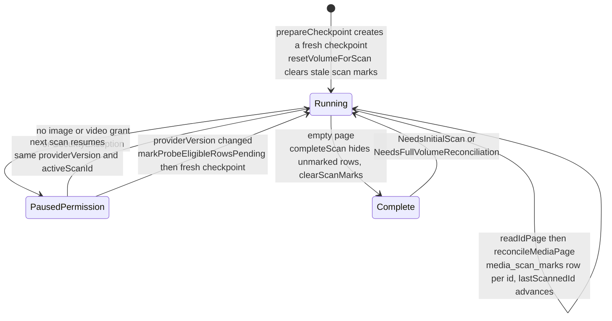
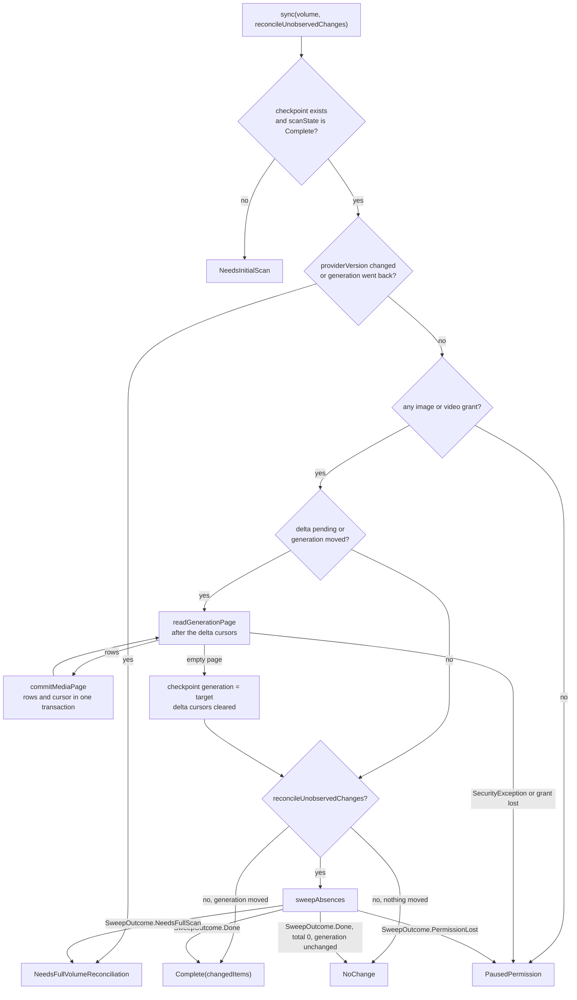
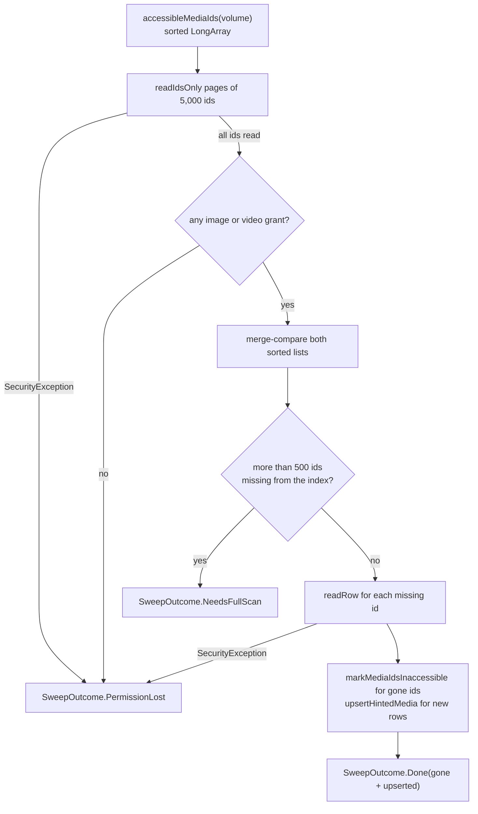
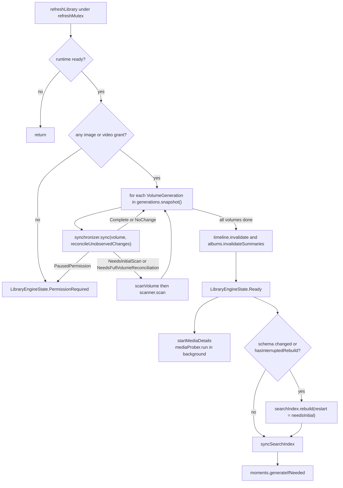
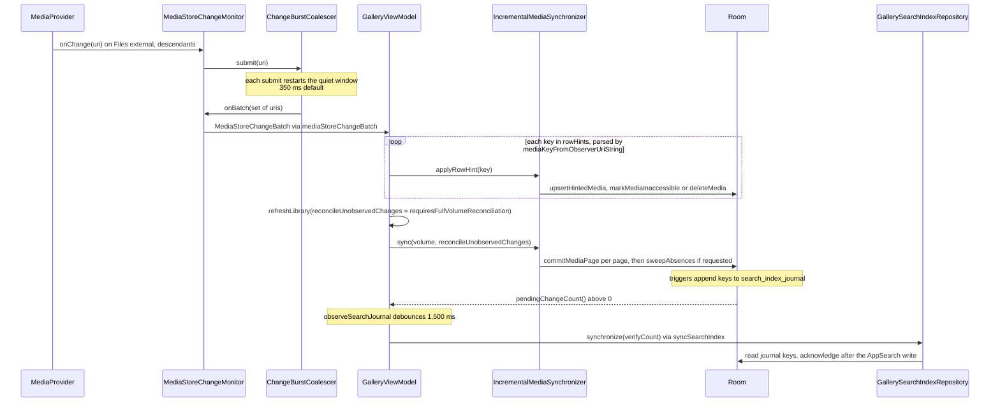

# Library sync: MediaStore to Room

MediaStore owns every shared photo and video. Room's `media_items` table is a rebuildable index of it, keyed by `(volumeName, mediaStoreId)`. This document describes how that index is built and kept current. A resumable, paged **initial scan** (`InitialMediaScanner`) builds it. A generation-bounded **incremental sync** (`IncrementalMediaSynchronizer`), with an id-only **absence sweep** on cold start, keeps it current. A coalesced **ContentObserver** (`MediaStoreChangeMonitor`) triggers both. `GalleryViewModel.refreshLibrary` orchestrates the work and starts two follow-ups: a background **media-details probe** (`PendingMediaProber`) and the journal-driven **search index sync** (`syncSearchIndex`). Rows that MediaStore stops showing are hidden (`isAccessible = 0`), not deleted, unless a row hint proves the file is really gone under full access.

## Where it lives

- [InitialMediaScanner.kt](../../core/data/src/main/kotlin/com/librestatic/lightforge/core/data/InitialMediaScanner.kt): `ScanState`, `ScanProgress`, `InitialScanResult`, `MediaIndexStore`, `RoomMediaIndexStore`, `InitialMediaScanner.scan`, `prepareCheckpoint`, `markProbeEligibleRowsPending`, `MediaStoreRecord.toEntity`.
- [IncrementalMediaSynchronizer.kt](../../core/data/src/main/kotlin/com/librestatic/lightforge/core/data/IncrementalMediaSynchronizer.kt): `IncrementalMediaIndexStore`, `IncrementalSyncResult`, `RowHintResult`, `FolderReconcileResult`, `IncrementalMediaSynchronizer.sync`, `sweepAbsences`, `SweepOutcome`, `applyRowHint`, `reconcileFolder`.
- [PendingMediaProber.kt](../../core/data/src/main/kotlin/com/librestatic/lightforge/core/data/PendingMediaProber.kt): `PendingProbeStore`, `RoomPendingProbeStore`, `PendingMediaProber.run`.
- [MediaStoreChangeMonitor.kt](../../core/data/src/main/kotlin/com/librestatic/lightforge/core/data/MediaStoreChangeMonitor.kt): `MediaStoreChangeMonitor`, `ChangeBurstCoalescer`, `MediaStoreChangeBatch`, `mediaStoreChangeBatch`, `mediaKeyFromObserverUri`.
- [MediaStoreGenerationProbe.kt](../../core/mediastore/src/main/kotlin/com/librestatic/lightforge/core/mediastore/MediaStoreGenerationProbe.kt): `VolumeGeneration`, `MediaStoreGenerationProbe.snapshot`.
- [MediaStoreReader.kt](../../core/mediastore/src/main/kotlin/com/librestatic/lightforge/core/mediastore/MediaStoreReader.kt): `readIdPage`, `readIdsOnly`, `readGenerationPage`, `readRow`, `readFolderPage`, `MediaStoreRecord.probed`.
- [MediaFileProber.kt](../../core/mediastore/src/main/kotlin/com/librestatic/lightforge/core/mediastore/MediaFileProber.kt): `needsFileProbe`, `MediaFileProbe`, `MediaFileProber`.
- [LibraryDao.kt](../../core/database/src/main/kotlin/com/librestatic/lightforge/core/database/LibraryDao.kt): `resetVolumeForScan`, `reconcileMediaPage`, `revealReappearedMedia`, `commitMediaPage`, `completeVolumeScan`, `hideItemsNotSeenInScan`, `clearScanMarks`, `upsertMedia`, `markMediaInaccessible`, `markMediaIdsInaccessible`, `accessibleIdsUnderPrefix`, `hideFolderRowsNotIn`, `deleteMedia`, `pendingProbeRows`, `applyProbeResults`, `markProbeEligibleRowsPending`.
- [LibraryEntities.kt](../../core/database/src/main/kotlin/com/librestatic/lightforge/core/database/LibraryEntities.kt): `MediaItemEntity` (`media_items`, `needsProbe`), `MediaStoreCheckpointEntity` (`media_store_checkpoints`), `MediaScanMarkEntity` (`media_scan_marks`), `PendingProbeRow`, `ProbeResultRow`.
- [GalleryDatabase.kt](../../core/database/src/main/kotlin/com/librestatic/lightforge/core/database/GalleryDatabase.kt): version 36. `Migration33To34` adds `needsProbe`, `Migration34To35` adds `search_index_journal`, `Migration35To36` adds `media_scan_marks`.
- [SearchIndexJournal.kt](../../core/database/src/main/kotlin/com/librestatic/lightforge/core/database/SearchIndexJournal.kt): `SearchIndexJournalEntity` (`search_index_journal`), `SearchIndexJournalSchema.installTriggers`.
- [GallerySearchIndexRepository.kt](../../core/data/src/main/kotlin/com/librestatic/lightforge/core/data/GallerySearchIndexRepository.kt): `RoomSearchIndexJournal`, `rebuild`, `synchronize`, `pendingChangeCount`, `hasInterruptedRebuild`.
- [SearchIndexCoordinator.kt](../../core/search/src/main/kotlin/com/librestatic/lightforge/core/search/SearchIndexCoordinator.kt): `synchronize`, `drain`, `SearchSyncResult`.
- [GalleryViewModel.kt](../../app/src/main/kotlin/com/librestatic/lightforge/GalleryViewModel.kt): `createRuntime`, the monitor callback in `init`, `refreshLibrary`, `scanVolume`, `startMediaDetails`, `syncSearchIndex`, `observeSearchJournal`, `onForeground`, `reconcileFolder`, `processWideRefreshMutex`.

## Initial scan checkpoint states

`ScanState` is stored as a string in `MediaStoreCheckpointEntity.scanState`. There is one checkpoint per volume.

1. `prepareCheckpoint` resumes the existing checkpoint only when three things hold: `providerVersion` matches, `activeScanId` is set, and the state is not `Complete`. Otherwise it writes a fresh checkpoint (`lastScannedId = -1`, a new `activeScanId`, `Running`) with `resetVolumeForScan`. That call also deletes marks left by an abandoned scan (`clearStaleScanMarks`); no rows are deleted.
2. A `providerVersion` change includes the app's own index-format suffix (`+lfN`). In that case, `markProbeEligibleRowsPending` first sets `needsProbe = 1` on the existing rows that a newer probe could improve. Unchanged rows are not rewritten by the scan, so without this step they would never be probed again. The call runs before the new checkpoint is stored, so a crash between the two repeats it.
3. Each loop iteration checks cancellation and `canReadAnyMedia`, then reads up to `pageSize` (256) ids after `lastScannedId` with `readIdPage`. Page reads are raw: no file is opened, and `toEntity` sets `needsProbe` from `needsFileProbe()` unless the record was already `probed`. `reconcileMediaPage` commits each page and the advanced checkpoint in one transaction. In that transaction, rows seen again get a `media_scan_marks` row instead of an UPDATE of `media_items`, because every `media_items` UPDATE invalidates every observed timeline and folder query. `revealReappearedMedia` re-shows rows that were hidden, and only new or changed rows are fully upserted.
4. An empty page ends the scan. The checkpoint becomes `Complete` and `activeScanId` is cleared. Then `completeVolumeScan` runs `hideItemsNotSeenInScan`, which hides each accessible row that has neither `lastSeenScanId` nor a scan mark equal to the finished scan id. Finally `clearScanMarks` empties the marks.
5. A missing grant or a `SecurityException` writes `PausedPermission` and returns `InitialScanResult.PausedPermission`. The cursor and the marks survive, so the next scan continues where this one stopped.

## Incremental sync decision

1. The delta target is persisted first (`deltaTargetGeneration`, `deltaGenerationCursor`, `deltaMediaStoreIdCursor = Long.MAX_VALUE`). If the process is killed, it resumes the same bounded delta instead of starting over.
2. `commitMediaPage` writes each page together with its cursor. The loop fails fast if a page does not advance.
3. When the delta is drained, the checkpoint's `generation` becomes the target, the cursors are reset, and `lastSuccessfulSyncMillis` is stamped.
4. Generation deltas contain changed rows but never tombstones. A sync that must also notice removals (`reconcileUnobservedChanges = true`) therefore finishes with `sweepAbsences` instead of asking for a full volume scan. This happens on runtime start, on explicit refreshes, and for observer batches without row identity.

## Absence sweep

- The sweep reads ids only: no records, no file opens. It runs inside the caller's refresh lock and must not take `refreshMutex` itself.
- Indexed ids that MediaStore no longer lists are **hidden**, not deleted, because absence can also mean a revoked selection. They are hidden in chunks of 500 (`SweepReadLimit`).
- Listed ids that are missing from the index are read one by one with `readRow` and upserted with token 0. If more than 500 are missing, a full scan is cheaper, so the sweep returns `NeedsFullScan`.

## Orchestration in refreshLibrary

- `refreshLibrary(reconcileUnobservedChanges, invalidateViews)` holds `refreshMutex`, which is `processWideRefreshMutex`. Because of it, a second `MainActivity`, which has its own view model, cannot run a scan at the same time. `reconcileFolder` shares the same lock, so a folder sweep never interleaves with a scan's mark-and-sweep.
- Callers:
  - runtime start (`reconcileUnobservedChanges = true`);
  - `onForeground` (plain);
  - `onPermissionRequestResult` (`invalidateViews = true`);
  - `refreshFolders` (`reconcileUnobservedChanges = true`);
  - plain refreshes after the app's own writes (export completion and similar);
  - the observer callback (`reconcileUnobservedChanges = batch.requiresFullVolumeReconciliation`).
- The engine state only flips to `Indexing` on a first pass, when the library is not yet `Ready`, or whenever `scanVolume` runs. Routine syncs keep a usable timeline on screen.
- **Media details:** `startMediaDetails` starts `PendingMediaProber.run` unless a run is already active. It reads `pendingProbeRows` newest first, 64 rows at a time with 4 files in parallel. It probes size, duration and image headers, then applies each batch in one transaction (`applyProbeResults`), guarded by `generationModified`. It takes no refresh lock and never delays `Ready`. While it runs, `libraryMaintenance` reports `LibraryMaintenance.MediaDetails`.
- **Search:** Room triggers record every relevant change to `media_items`, `media_ocr`, `media_labels` and `label_suppressions` in `search_index_journal`. `syncSearchIndex` calls `searchIndex.synchronize`, which drains the journal into AppSearch. A full rebuild happens in three cases:
  - the drain fails;
  - the once-per-process document-count check (`verifyCount = !searchIndexVerified`) finds a mismatch;
  - the stored `schema` preference differs from `MediaSearchSchema.Version`. This rebuild restarts from scratch; an interrupted rebuild instead resumes from its checkpoint.
- Moments are then regenerated with `generateIfNeeded`. Maintenance failures are logged, not shown as a library error.

## Observer to Room to search index

1. One descendant observer is registered on `MediaStore.Files.getContentUri(VOLUME_EXTERNAL)`. Callbacks with a null URI are submitted too.
2. `ChangeBurstCoalescer` keeps a pending set and cancels and relaunches its drain job on every submit, so a camera burst becomes one batch after the quiet window.
3. `mediaKeyFromObserverUri` yields a `MediaKey` only for `content://media/<volume>/.../<id>` URIs whose volume is not the synthetic `external`. Any URI that does not parse, or an empty set, sets `requiresFullVolumeReconciliation`. Most notifications name `external`, so most batches take the delta-plus-sweep path rather than a full rescan.
4. `applyRowHint` maps each `MediaStoreRow` result as follows. It writes only the row, never the checkpoint, because it runs outside the refresh lock.
   - `MediaStoreRow.Present`: upsert (`RowHintResult.Upserted`).
   - `MediaStoreRow.Hidden`: `markMediaInaccessible` (`Hidden`).
   - `MediaStoreRow.Absent`: `deleteMedia` (`Deleted`) only with full image and video access and no file left on disk; otherwise `PermissionLost` or `Hidden`.
5. Row hints are not indexed directly: the journal triggers record their writes. `observeSearchJournal` collects `pendingChangeCount()` and drains it only while the engine is `Ready`, so it never overlaps a scan.

## Failure and edge cases

- **Partial access (selected photos):** neither a scan nor the sweep can tell a deleted file from a deselected one. Both hide rows instead of deleting them, so favourites, albums and ML results survive and come back when the row is visible again. `applyRowHint` returns `PermissionLost` for an absent row unless both grants are `GrantLevel.Full`.
- **Permission revoked mid-run:** grants are checked before and after every page read. The scan stores `PausedPermission`. The sync, or its sweep, returns `PausedPermission`, and the delta cursor stays persisted. `refreshLibrary` then calls `permissions.revalidate()` and shows `PermissionRequired`.
- **Probe without access:** `PendingMediaProber` stops on a `SecurityException` and leaves the row flagged. Any other failure clears the flag with empty details. If a whole batch applies 0 rows (every row changed meanwhile), the run stops instead of spinning.
- **`.nomedia`, or file still on disk:** an absent row whose file still exists (`fileStillExists`, through All files access paths) is hidden, not deleted.
- **Provider version change or generation rollback** (MediaProvider database reset, or an index-format bump): `NeedsFullVolumeReconciliation`. Existing rows are queued for probing, a fresh scan id is created, and unseen rows are hidden at the end.
- **Many new rows found by the sweep:** more than 500 unindexed ids escalates to a full scan.
- **Cancellation** propagates (`ensureActive`). `refreshLibrary` restores the previous engine state if it was left at `Indexing`. Probe batches are applied under `NonCancellable`.
- **Pages that do not advance** throw (`check`), which turns into `LibraryEngineState.Error` instead of an endless loop.
- **Folder operations** call `reconcileFolder`. It re-reads one subtree with `readFolderPage` and hides the rows under the prefix that were not returned (`hideFolderRowsNotIn`).

## Invariants

- Media identity is always `(volumeName, mediaStoreId)`, and checkpoints are per volume.
- Each page write commits in the same Room transaction as its checkpoint advance. Likewise, each probe batch is a single transaction. So replay after process death is idempotent.
- Neither the scan, the delta sync nor the sweep deletes rows. Only `applyRowHint` deletes, and only under full access with the file gone from disk.
- Records are never held beyond one page. The sweep holds the volume's ids, a few bytes each, but never its records.
- Scans, delta syncs, sweeps and folder reconciles are serialized by the process-wide refresh mutex. Row hints and the media probe write only rows.
- Rows written without a scan token (`lastSeenScanId = 0`) inherit the active scan id in `upsertMedia`, so a concurrent scan's sweep does not hide them. A raw rewrite of an unchanged file keeps what an earlier probe found.
- The search index only acknowledges a journal key after the matching AppSearch write.

> ADR-003 was amended on 2026-10-28 to match this behaviour.

## Related

- [ADR-002: MediaStore and Room ownership](../adr/ADR-002-mediastore-room-source-of-truth.md)
- [ADR-003: Generation-based synchronization](../adr/ADR-003-incremental-sync-generations.md)
- [ADR-025: Keep external grants outside library identity](../adr/ADR-025-external-uri-without-library-identity.md) (external `ACTION_VIEW`/`ACTION_EDIT` URIs never enter this index)
- [ADR-006: AppSearch LocalStorage](../adr/ADR-006-appsearch-localstorage.md)
- [App startup](app-startup.md)
