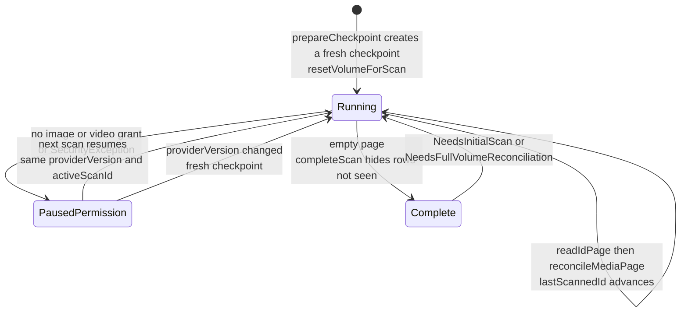
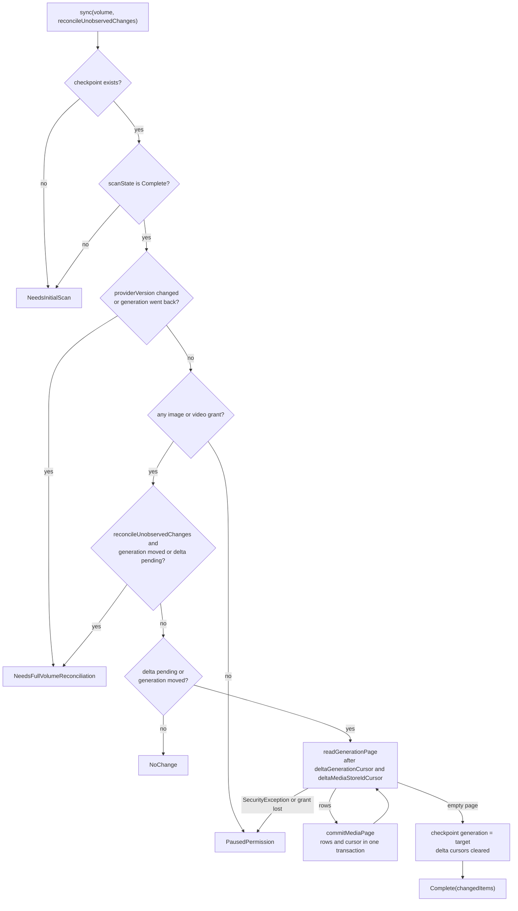
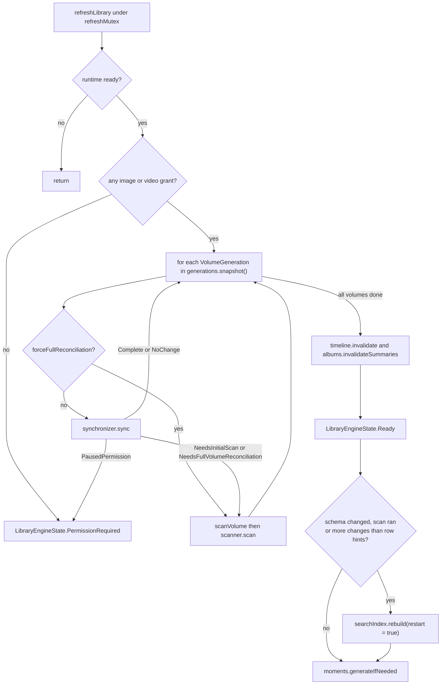
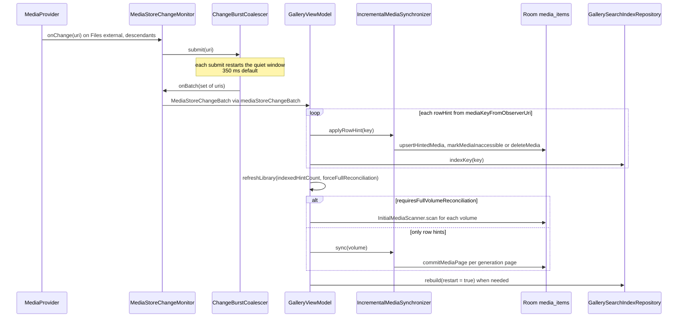

# Library sync: MediaStore to Room

MediaStore owns every shared photo and video; Room's `media_items` table is a rebuildable index of it, keyed by `(volumeName, mediaStoreId)`. This document describes how the index is built and kept current: a resumable, paged **initial scan** (`InitialMediaScanner`), a generation-bounded **incremental sync** (`IncrementalMediaSynchronizer`), a coalesced **ContentObserver** (`MediaStoreChangeMonitor`) that triggers both, and the orchestration in `GalleryViewModel.refreshLibrary`, which also starts the search-index and moments follow-up work. Rows that MediaStore stops showing are hidden (`isAccessible = 0`), not deleted, unless a row hint proves the file is really gone under full access.

## Where it lives

- [InitialMediaScanner.kt](../../core/data/src/main/kotlin/com/librestatic/lightforge/core/data/InitialMediaScanner.kt): `ScanState`, `ScanProgress`, `InitialScanResult`, `MediaIndexStore`, `RoomMediaIndexStore`, `InitialMediaScanner.scan`, `prepareCheckpoint`, `MediaStoreRecord.toEntity`.
- [IncrementalMediaSynchronizer.kt](../../core/data/src/main/kotlin/com/librestatic/lightforge/core/data/IncrementalMediaSynchronizer.kt): `IncrementalMediaIndexStore`, `IncrementalSyncResult`, `RowHintResult`, `FolderReconcileResult`, `IncrementalMediaSynchronizer.sync`, `applyRowHint`, `reconcileFolder`.
- [MediaStoreChangeMonitor.kt](../../core/data/src/main/kotlin/com/librestatic/lightforge/core/data/MediaStoreChangeMonitor.kt): `MediaStoreChangeMonitor`, `ChangeBurstCoalescer`, `MediaStoreChangeBatch`, `mediaStoreChangeBatch`, `mediaKeyFromObserverUri`.
- [MediaStoreGenerationProbe.kt](../../core/mediastore/src/main/kotlin/com/librestatic/lightforge/core/mediastore/MediaStoreGenerationProbe.kt): `VolumeGeneration`, `MediaStoreGenerationProbe.snapshot`.
- [MediaStoreReader.kt](../../core/mediastore/src/main/kotlin/com/librestatic/lightforge/core/mediastore/MediaStoreReader.kt): `MediaStorePageSource.readIdPage`, `MediaStoreDeltaSource.readGenerationPage`, `readRow`, `readFolderPage`.
- [LibraryDao.kt](../../core/database/src/main/kotlin/com/librestatic/lightforge/core/database/LibraryDao.kt): `resetVolumeForScan`, `reconcileMediaPage`, `commitMediaPage`, `completeVolumeScan`, `hideItemsNotSeenInScan`, `upsertMedia`, `markMediaInaccessible`, `hideFolderRowsNotIn`, `deleteMedia`.
- [LibraryEntities.kt](../../core/database/src/main/kotlin/com/librestatic/lightforge/core/database/LibraryEntities.kt): `MediaItemEntity` (`media_items`), `MediaStoreCheckpointEntity` (`media_store_checkpoints`).
- [GalleryViewModel.kt](../../app/src/main/kotlin/com/librestatic/lightforge/GalleryViewModel.kt): `createRuntime`, the monitor callback in `init`, `refreshLibrary`, `scanVolume`, `onForeground`, `reconcileFolder`, `processWideRefreshMutex`.
- [GallerySearchIndexRepository.kt](../../core/data/src/main/kotlin/com/librestatic/lightforge/core/data/GallerySearchIndexRepository.kt): `indexKey`, `rebuild`.

## Initial scan checkpoint states

`ScanState` is stored as a string in `MediaStoreCheckpointEntity.scanState`, one checkpoint per volume.

1. `prepareCheckpoint` resumes the existing checkpoint only if `providerVersion` matches, `activeScanId` is set and the state is not `Complete`. Otherwise it writes a fresh checkpoint (`lastScannedId = -1`, new `activeScanId`, `Running`) with `resetVolumeForScan`; no rows are deleted.
2. Each loop iteration checks cancellation and `canReadAnyMedia`, reads up to `pageSize` (256) ids after `lastScannedId` with `readIdPage`, and commits the page plus the advanced checkpoint in one transaction (`reconcileMediaPage`). Known rows only get `lastSeenScanId` and `isAccessible = 1` updated (`markMediaSeen`); new or changed rows are fully upserted.
3. An empty page ends the scan: the checkpoint becomes `Complete`, `activeScanId` is cleared and `completeVolumeScan` runs `hideItemsNotSeenInScan`, a mark-and-sweep that hides every row whose `lastSeenScanId` is not the finished scan id.
4. A missing grant or `SecurityException` writes `PausedPermission` and returns `InitialScanResult.PausedPermission`. The cursor survives, so the next scan continues where it stopped.

## Incremental sync decision

1. Generation deltas only contain changed rows, never tombstones, so a sync that must also notice removals (`reconcileUnobservedChanges = true`, used on runtime start and explicit refreshes) asks for a full reconciliation as soon as the generation moved.
2. The delta target is persisted first (`deltaTargetGeneration`, `deltaGenerationCursor`, `deltaMediaStoreIdCursor = Long.MAX_VALUE`), so a killed process resumes the same bounded delta instead of starting over.
3. Each page and its cursor are committed together through `commitMediaPage`; the loop fails fast if a page does not advance.
4. When the delta is drained, the checkpoint's `generation` becomes the target, the cursors are reset and `lastSuccessfulSyncMillis` is stamped.

## Orchestration in refreshLibrary

- `refreshLibrary` holds `refreshMutex`, which is `processWideRefreshMutex`: a second `MainActivity` (with its own view model) cannot run a scan concurrently, and `reconcileFolder` shares the same lock so its folder sweep never interleaves with a scan's mark-and-sweep.
- Callers: runtime start (`reconcileUnobservedChanges = true`), `onForeground` (plain), `onPermissionRequestResult` (`invalidateViews = true`), `refreshFolders`, export completion and the observer callback (`forceFullReconciliation` from the batch).
- The state only flips to `Indexing` on a first pass or when the library is not yet `Ready`, or whenever `scanVolume` runs; routine syncs keep a usable timeline on screen.
- Timeline and album invalidation happens after scans, reconciliations, explicit refreshes, non-zero changes and the first pass of a runtime.
- Search follow-up: the AppSearch index is rebuilt from Room when the stored `schema` preference differs from `MediaSearchSchema.Version`, when a scan ran, or when `changedItems` exceeds the number of row hints already indexed one by one. Moments are then regenerated with `generateIfNeeded`. Maintenance failures are logged, not shown as a library error.

## Observer to Room to search index

1. One descendant observer is registered on `MediaStore.Files.getContentUri(VOLUME_EXTERNAL)`; null-URI callbacks are submitted too.
2. `ChangeBurstCoalescer` keeps a pending set and cancels and relaunches its drain job on every submit, so a camera burst becomes one batch after the quiet window.
3. `mediaKeyFromObserverUri` only yields a `MediaKey` for `content://media/<volume>/.../<id>` URIs whose volume is not the synthetic `external`. Any URI that does not parse, or an empty set, sets `requiresFullVolumeReconciliation`.
4. `applyRowHint` maps `MediaStoreRow.Present` to an upsert (`RowHintResult.Upserted`), `MediaStoreRow.Hidden` to `markMediaInaccessible` (`Hidden`), and `MediaStoreRow.Absent` to `deleteMedia` (`Deleted`) only with full image and video access and no file left on disk; otherwise `PermissionLost` or `Hidden`. It writes only the row, never the checkpoint, because it runs outside the refresh lock.

## Failure and edge cases

- **Partial access (selected photos).** A scan cannot tell a deleted file from a deselected one, so `completeVolumeScan` hides rows instead of deleting them; favourites, albums and ML results survive and return when the row is visible again. `applyRowHint` returns `PermissionLost` for an absent row unless both grants are `GrantLevel.Full`.
- **Permission revoked mid-run.** Grants are checked before and after every page read. The scan persists `PausedPermission`; the sync returns `PausedPermission` with its persisted cursor. `refreshLibrary` then calls `permissions.revalidate()` and shows `PermissionRequired`.
- **`.nomedia` or file still on disk.** An absent row whose file still exists (`fileStillExists`, through All files access paths) is hidden, not deleted.
- **Provider version change or generation rollback** (MediaProvider database reset) forces `NeedsFullVolumeReconciliation`; a fresh scan id is created and unseen rows are hidden at the end.
- **Notifications on the `external` aggregate URI** carry no row identity, so at HEAD each such batch forces a full rescan of every volume.
- **Cancellation** propagates (`ensureActive`); `refreshLibrary` restores the previous engine state if it was left at `Indexing`.
- **Pages that do not advance** throw (`check`), turning into `LibraryEngineState.Error` rather than looping forever.
- **Folder operations** call `reconcileFolder`, which re-reads one subtree with `readFolderPage` and hides rows under the prefix that were not returned (`hideFolderRowsNotIn`).

## Invariants

- Media identity is always `(volumeName, mediaStoreId)`; checkpoints are per volume.
- Every page write and its checkpoint advance are one Room transaction, so replay after process death is idempotent.
- Neither the scan nor the delta sync deletes rows; only `applyRowHint` deletes, and only under full access with the file gone from disk.
- A scan or delta sync never materializes the full id list of the library; memory is bounded by `pageSize`.
- Scans, delta syncs and folder reconciles are serialized by the process-wide refresh mutex; row hints write only rows.
- Rows written without a scan token (`lastSeenScanId = 0`) inherit the active scan id in `upsertMedia`, so a concurrent scan's sweep does not hide them.

> **Note — differs from ADR-003:** ADR-003 says reconciliation is used "to detect deletions". In code, reconciliation (`completeVolumeScan`, `hideFolderRowsNotIn`) only hides absent rows; physical deletion happens only through a row hint under full access.

## Related

- [ADR-002: MediaStore and Room ownership](../adr/ADR-002-mediastore-room-source-of-truth.md)
- [ADR-003: Generation-based synchronization](../adr/ADR-003-incremental-sync-generations.md)
- [ADR-025: Keep external grants outside library identity](../adr/ADR-025-external-uri-without-library-identity.md) (external `ACTION_VIEW`/`ACTION_EDIT` URIs never enter this index)
- [ADR-006: AppSearch LocalStorage](../adr/ADR-006-appsearch-localstorage.md)
- [App startup](app-startup.md)
