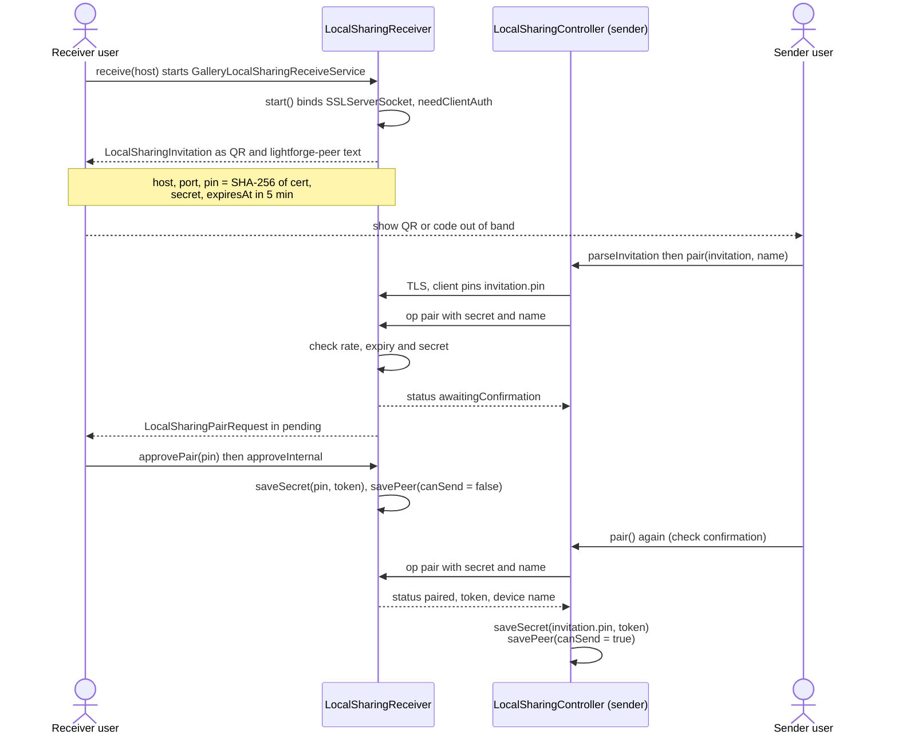
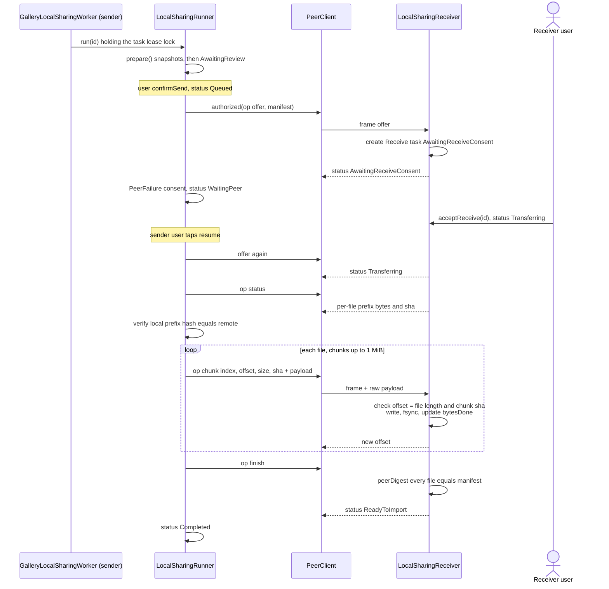
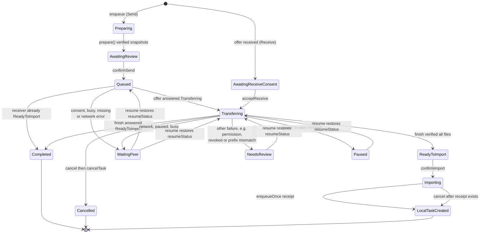
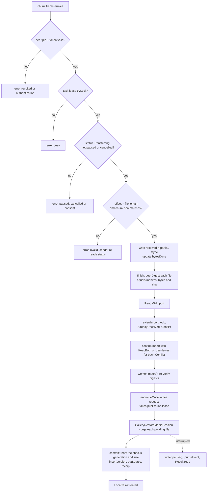

# Local network transfer

Local sharing sends original photos and videos (with location stripped by default) from one Lightforge device to another on the same network, without any server. There is no automatic discovery. The receiving device starts a foreground listener on an address the user types in, and shows a short-lived invitation (QR code or text). The sender pairs once using that invitation. After pairing, each transfer is a series of single-request mutual-TLS connections: the receiver's certificate is pinned, and every request also carries a per-peer bearer token. Both sides keep a durable, resumable task under `files/local-sharing/tasks/<uuid>/`. The receiver verifies every byte against the sender's manifest. Received files reach the gallery only after the user reviews the import, which publishes them into MediaStore through the journalled restore writer.

## Where it lives

- [LocalSharingModels.kt](../../feature/localsharing/src/main/kotlin/com/librestatic/lightforge/feature/localsharing/LocalSharingModels.kt): `LocalSharingStatus`, `LocalSharingDirection`, `LocalSharingTransfer` (`terminal`, `interrupted`), `LocalSharingManifest`, `LocalSharingEntry`, `LocalSharingPeer`, `LocalSharingInvitation`, `LocalSharingPairRequest`, limits `LOCAL_SHARING_MAX_FILES`, `LOCAL_SHARING_MAX_FILE_BYTES`, `LOCAL_SHARING_MAX_TOTAL_BYTES`, `PEER_FRAME_LIMIT`, `PEER_CHUNK_LIMIT`, `peerDigest`, `PeerStopped`, `PeerFailure`.
- [LocalSharingTls.kt](../../feature/localsharing/src/main/kotlin/com/librestatic/lightforge/feature/localsharing/LocalSharingTls.kt): `PeerTls` (AndroidKeyStore P-256 identity, `pin`, `context`, `remotePin`, `saveSecret`, `secret`, `revoke`, `randomSecret`).
- [LocalSharingClient.kt](../../feature/localsharing/src/main/kotlin/com/librestatic/lightforge/feature/localsharing/LocalSharingClient.kt): `PeerClient.request`, `PeerClient.authorized`, `PeerSockets`.
- [LocalSharingCodec.kt](../../feature/localsharing/src/main/kotlin/com/librestatic/lightforge/feature/localsharing/LocalSharingCodec.kt): `PeerCodec.write`, `PeerCodec.read` (length-prefixed JSON frames), `PeerCodec.invitation` (`lightforge-peer:` text), `PeerCodec.manifest`.
- [LocalSharingReceiver.kt](../../feature/localsharing/src/main/kotlin/com/librestatic/lightforge/feature/localsharing/LocalSharingReceiver.kt): `LocalSharingReceiver.start`, `serve`, `pair`, `approveInternal`, `authorized` (ops `offer`, `status`, `cancel`, `chunk`, `finish`), `LocalSharingReceiverState`.
- [LocalSharingRunner.kt](../../feature/localsharing/src/main/kotlin/com/librestatic/lightforge/feature/localsharing/LocalSharingRunner.kt): `LocalSharingRunner.run`, `prepare`, `send`, `import`, `cancelTask`, `needsRetry`.
- [LocalSharingController.kt](../../feature/localsharing/src/main/kotlin/com/librestatic/lightforge/feature/localsharing/LocalSharingController.kt): `receive`, `approvePair`, `rejectPair`, `pair`, `revoke`, `enqueue`, `confirmSend`, `acceptReceive`, `reviewImport`, `confirmImport`, `pause`, `resume`, `regrant`, `cancel`, `reconcile`.
- [LocalSharingServices.kt](../../feature/localsharing/src/main/kotlin/com/librestatic/lightforge/feature/localsharing/LocalSharingServices.kt): `LocalSharingServices`, `LocalSharingSourcePort`, `LocalSharingImportPort`, `LocalSharingImportDisposition` (`Add`, `AlreadyReceived`, `Conflict`), `LocalSharingConflictChoice` (`KeepBoth`, `UseNewest`).
- [LocalSharingStore.kt](../../feature/localsharing/src/main/kotlin/com/librestatic/lightforge/feature/localsharing/LocalSharingStore.kt): `task.json`, `peers.json`, `secrets/<pin>.bin`, `received-<n>.partial`, `lease`, `cleanupPrivate`.
- [LocalSharingContent.kt](../../feature/localsharing/src/main/kotlin/com/librestatic/lightforge/feature/localsharing/LocalSharingContent.kt): host field, invitation QR (`peerQr`, `readPeerQr`), pair approval, resume, pause, cancel and regrant buttons.
- [GalleryLocalSharingWorker.kt](../../app/src/main/kotlin/com/librestatic/lightforge/GalleryLocalSharingWorker.kt): `GalleryLocalSharingWorker` (unique WorkManager job `android-sharing-<id>`, `Result.retry` when `needsRetry`), `services`, `controller`, `schedule`.
- [GalleryLocalSharingReceiveService.kt](../../app/src/main/kotlin/com/librestatic/lightforge/GalleryLocalSharingReceiveService.kt): `dataSync` foreground service that owns the `LocalSharingReceiver`.
- [GalleryLocalSharingSourcePort.kt](../../app/src/main/kotlin/com/librestatic/lightforge/GalleryLocalSharingSourcePort.kt): `retain`, `release`, `prepare`, `requireLocationFree`.
- [GalleryLocalSharingImportPort.kt](../../app/src/main/kotlin/com/librestatic/lightforge/GalleryLocalSharingImportPort.kt): `review`, `existing`, `enqueueOnce`, `cancel`, `commit` (`peer_import_versions`, `peer_import_sources`, `gallery_restore_receipts`).
- [GalleryRestoreMediaSession.kt](../../app/src/main/kotlin/com/librestatic/lightforge/GalleryRestoreMediaSession.kt): `stage`, `commit`, `pause`, `verifyBeforeAbort`, `abort`.
- [GalleryRemoteBackupWorker.kt](../../app/src/main/kotlin/com/librestatic/lightforge/GalleryRemoteBackupWorker.kt): `ownStorageNetworkAllowed` (the `networkAllowed` gate; `ACCESS_LOCAL_NETWORK` on SDK 37+ with target 37+).

## Pairing

1. The receiver identity is a self-signed `CN=Lightforge Local Peer` EC P-256 key held in AndroidKeyStore. Its **pin** is the SHA-256 of the certificate, and that pin is the peer ID on both sides.
2. Only the client pins the server certificate (`PeerTls.context(expectedPin)`). The server accepts any single valid EC client certificate at the TLS layer, then authorizes in the application layer. A `pair` op needs the invitation `secret`. Every other op needs a stored, non-revoked peer whose ID equals the client's certificate pin, plus a constant-time match of its bearer `token`.
3. An invitation can approve only one peer (`consumed`). It accepts at most 4 pending requests (`busy`) and 60 attempts per minute (`rate`), and expires after 5 minutes (`expired`). The receiver shows the requester's name, host and pin before the user approves.
4. Tokens are 32 random bytes in hex. They are stored AES-GCM encrypted under a separate AndroidKeyStore key, with the pin as AAD (`secrets/<pin>.bin`). `revoke(pin)` deletes the token, marks the peer `revoked`, and pauses that peer's open transfers.
5. The receiver records the sender with `canSend = false`, because it does not know a trusted receive port for that device. Sending in the other direction needs a pairing from the other side.

## Transfer protocol

- **Framing (`PeerCodec`):** each request opens a fresh TLS 1.2 or 1.3 connection and sends one frame: a 4-byte big-endian length followed by UTF-8 JSON (`v` = 1, at most `PEER_FRAME_LIMIT` = 1 MiB). A `chunk` frame is followed by the raw payload bytes (at most `PEER_CHUNK_LIMIT`). The reply is one JSON frame, or `{"error": reason}`, which becomes `PeerFailure(reason)`. Client timeouts are 15 s to connect, 30 s to read, and 30 min for `status` and `finish`, which hash whole files.
- **Resume point:** the sender never trusts its own progress counter. The receiver's `status` op hashes the actual on-disk prefix of each `received-<n>.partial`. The sender recomputes the same prefix from its snapshot and requires the hashes to match before it continues from that offset.
- **Sender snapshots:** `prepare()` asks `LocalSharingSourcePort.prepare` to make immutable copies in a fresh `attempt-<uuid>` directory. With `stripLocation`, a verified sanitized derivative is used (`requireLocationFree`). The runner re-hashes each copy and fsyncs it, and the URI grants are released (`release`). Each file is hashed again just before it is sent.
- **Idempotent offer:** offering the same `id` again must carry the same manifest from the same pin. If the receiver is already at `ReadyToImport`, `Importing` or `LocalTaskCreated`, the sender just marks itself `Completed`.

## LocalSharingStatus

- `Completed`, `Cancelled` and `LocalTaskCreated` are `terminal`. Pause, cancel and resume are allowed from any non-terminal state. The diagram shows them only from representative states.
- `pause()` and `revoke()` set `pauseRequested`, move the task to `Paused` and remember `resumeStatus`. `resume()` clears the failure and restores `resumeStatus`. If there is none, it picks a default: `Transferring` for Receive, `Preparing` for a Send without a manifest, `Queued` otherwise. Resume is refused for `failure = "corrupt"` and for revoked peers.
- The runner maps failures to statuses. `SecurityException`, `PeerFailure` `consent`/`paused`/`busy`/`missing`, and socket, connect or timeout errors go to `WaitingPeer`. Anything else goes to `NeedsReview`. Cancellation and `PeerStopped` keep the current status (`interrupted()`), so the WorkManager retry continues the same step.
- `needsRetry` (and `reconcile()` on screen entry) reschedules only `Preparing`, `Queued`, `Transferring`, `Importing`, or tasks with a cancel request. `WaitingPeer`, `Paused` and `NeedsReview` wait for the user to tap Resume.

## Receiver write, verify and import

1. Before accepting an `offer`, the receiver checks free space (`manifest.totalBytes` + 16 MiB) and a cap of 24 open tasks. `acceptReceive` checks the space again and creates empty files for zero-byte entries.
2. Each chunk must extend its file exactly at its current length, and the chunk's SHA-256 must match the header. The receiver writes and fsyncs before acknowledging. `finish` hashes every complete file against the manifest before moving to `ReadyToImport`.
3. `reviewImport` looks up `peer_import_versions` and `peer_import_sources` by peer pin, `sourceId` and `revision`. A revision already received with different bytes is rejected. Every `Conflict` needs a choice. `UseNewest` makes the new revision active only if its `modifiedMillis` is newer. `KeepBoth` adds a copy. Neither choice overwrites or deletes earlier items.
4. `enqueueOnce` is idempotent. A request file binds peer, transfer, manifest and choices, and the Room `gallery_restore_receipts` row is the commit marker. `GalleryRestoreMediaSession` writes pending MediaStore rows from a durable journal. The `commit` transaction then re-reads each published row (generation, size, not trashed), upserts it into the library, and records the version, the active source and the receipt.
5. A cancel before the receipt exists runs `importPort.cancel`: it re-verifies the inputs, aborts owned pending rows (`verifyBeforeAbort`, `abort`), and then `cleanupPrivate` deletes the `received-*.partial` files and `attempt-*` directories. If a receipt already exists, the task ends in `LocalTaskCreated`, not `Cancelled`.

## Failure and edge cases

- **No discovery:** the receiver user types the device's own IPv4 or IPv6 address (`peerHost`). An unreachable address or a changed IP shows up as `WaitingPeer` on the sender. The stored host and port change only when the sender pairs again with a new invitation.
- **Consent pending:** a sender that offers before the receiver accepts lands in `WaitingPeer` (`consent`) and is not retried automatically. The sender user has to tap Resume after the receiver accepts.
- **Sender-side cancel does not notify the receiver.** The receiver handles an `op cancel`, but no client code sends it. The receiver's partial task stays until its own user cancels it or the sender resumes.
- **Lost URI grants:** a failing `retain` in `enqueue`, or a `SecurityException` in `prepare`, leaves the task in `WaitingPeer` with `failure = "permission"`. The UI then offers `regrant`, which must reselect exactly the same items.
- **Network permission:** when `networkAllowed()` is false (SDK 37+ without `ACCESS_LOCAL_NETWORK`), the receiver refuses to start, and `send()` fails with `PeerFailure("permission")`, which the runner maps to `NeedsReview`.
- **Concurrent workers:** the per-task `lease` file lock makes a second runner return `false`. On the receiver, a busy lease answers `busy`. Only one publication runs at a time (`publication.lease`).
- **Interrupted receive service:** `onTimeout` and `onDestroy` close the listener and every accepted socket (`PeerSockets.close`), and `reportStartFailure` surfaces `network`.
- **Process death mid-chunk:** the next `status` re-hashes the real prefix. A torn write that leaves bytes not matching the sender makes the prefix-hash check fail, and the task goes to `NeedsReview`.
- **Cleanup failure during cancel** moves the task to `NeedsReview` with `failure = "cleanup"` instead of `Cancelled`.

## Invariants

- The peer ID is always the SHA-256 pin of the peer's TLS certificate, never a name, host or MediaStore ID.
- Apart from `pair`, every op requires mutual TLS, a known non-revoked pin, and a constant-time token match.
- The receiver accepts a byte only at the current verified end of its file. Completion requires full-file SHA-256 equality with the manifest.
- With `stripLocation`, the original is never sent. A sanitizer error fails the preparation and does not fall back to the original.
- Received files never enter MediaStore before the user reviews them. Publication never overwrites or deletes an existing item, and it is recorded once per `operationId` receipt.
- Durable state (`task.json`, `peers.json`, secrets) is written with `AtomicFile`, and received data is fsynced before it is acknowledged.

## Related

- No ADR covers local network sharing.
- [ADR-013: No Internet release](../adr/ADR-013-no-internet-release.md). **Note — differs from ADR-013:** ADR-013 says offline release manifests must not contain `INTERNET` or related network permissions. `app/src/main/AndroidManifest.xml` declares `INTERNET`, `ACCESS_NETWORK_STATE` and `ACCESS_LOCAL_NETWORK` for all flavors, and local sharing depends on them.
- [ADR-024: Bounded share grants](../adr/ADR-024-bounded-share-grants.md) covers share-sheet sharing through temporary URI grants, a separate path from this peer transfer.
- [ADR-009: Safe media writes](../adr/ADR-009-safe-media-writes.md): pending MediaStore publication used by the import side.
- Other flows: [private-album.md](private-album.md), [library-sync.md](library-sync.md).
