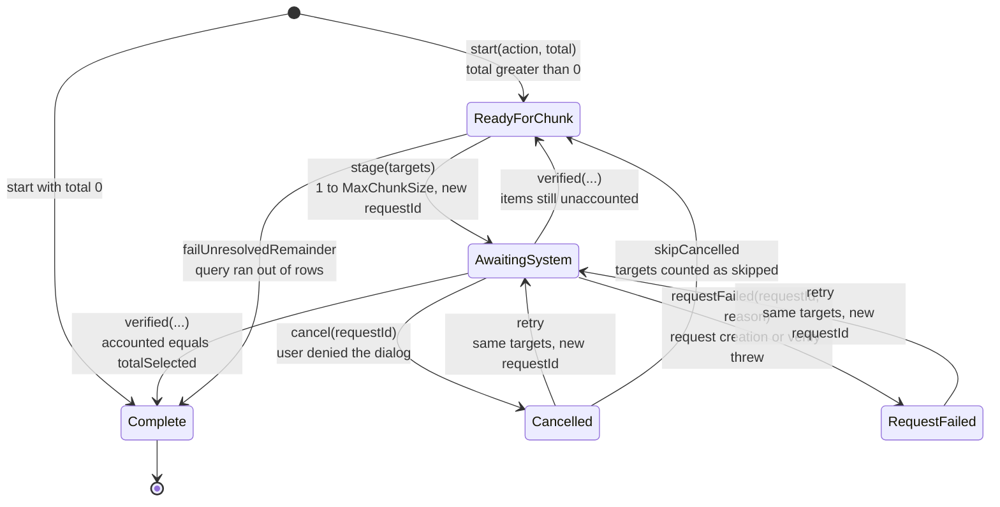
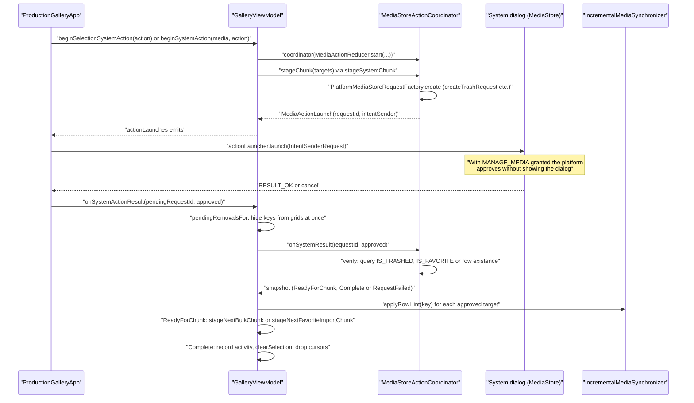
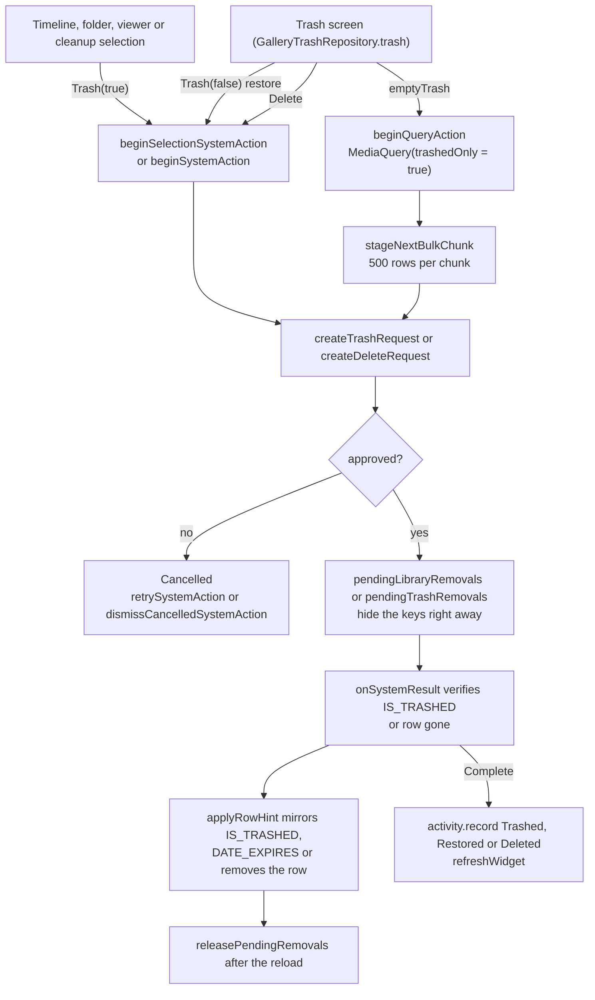
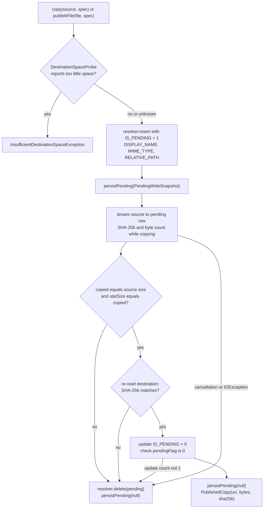

# Media actions: safe writes, trash and system confirmation

Lightforge never changes a shared photo or video behind the user's back. Favorite, trash, restore, permanent delete and in-place writes (rename, date repair, same-volume path move) go through the Android system confirmation requests (`MediaStore.createWriteRequest`, `createFavoriteRequest`, `createTrashRequest`, `createDeleteRequest`), driven by a small persisted state machine (`MediaActionReducer`) so that a request survives process death and a stale result cannot complete a newer one. After the user approves, the outcome is verified against MediaStore before it is counted. New files (editor exports, collages, copies of external URIs, video exports) are written by `PendingMediaWriter` as `IS_PENDING` rows that are published only after their size and SHA-256 match the source. Trash is MediaStore provider state: Room only mirrors `IS_TRASHED` and `DATE_EXPIRES`.

## Where it lives

- [MediaActionState.kt](../../core/mediastore/src/main/kotlin/com/librestatic/lightforge/core/mediastore/MediaActionState.kt): `MediaAction` (`Write`, `Favorite`, `Trash`, `Delete`, `MoveDelete`), `MediaActionTarget`, `MediaActionProgress`, `MediaActionPhase` (`ReadyForChunk`, `AwaitingSystem`, `Cancelled`, `RequestFailed`, `Complete`), `MediaActionSnapshot`, `VerifiedDisposition`, `MediaActionReducer` (`MaxChunkSize = 500`, `start`, `stage`, `cancel`, `retry`, `requestFailed`, `skipCancelled`, `verified`, `failUnresolvedRemainder`, `validate`).
- [MediaStoreActionCoordinator.kt](../../core/mediastore/src/main/kotlin/com/librestatic/lightforge/core/mediastore/MediaStoreActionCoordinator.kt): `MediaStoreActionCoordinator` (`stageChunk`, `recreateCurrentRequest`, `retryCurrent`, `onSystemResult`, private `verify`), `MediaActionLaunch`, `MediaStoreRequestFactory`, `PlatformMediaStoreRequestFactory`; the verified-move entry points `stageVerifiedMove` / `retryVerifiedMove` / `recreateVerifiedMove`.
- [MediaManagementAccess.kt](../../core/mediastore/src/main/kotlin/com/librestatic/lightforge/core/mediastore/MediaManagementAccess.kt): `canManageMedia`, `requestIntent` (Android 12+ `MANAGE_MEDIA`).
- [PendingMediaWriter.kt](../../core/mediastore/src/main/kotlin/com/librestatic/lightforge/core/mediastore/PendingMediaWriter.kt): `MediaWriteSpec`, `PendingWriteSnapshot`, `PublishedCopy`, `DestinationSpaceProbe`, `InsufficientDestinationSpaceException`, `PendingMediaWriter.copy`, `publishFile`, `stageStream`, `prepareMove`, `recoverOwnedPending`.
- [GalleryTrashRepository.kt](../../core/data/src/main/kotlin/com/librestatic/lightforge/core/data/GalleryTrashRepository.kt): `trash` (paged `TrashPagingSource`), `count`, `countFlow`, `emptyTrashQuery`, `restoreAction`, `permanentDeleteAction`.
- [GalleryViewModel.kt](../../app/src/main/kotlin/com/librestatic/lightforge/GalleryViewModel.kt): `beginSystemAction`, `beginSelectionSystemAction`, `emptyTrash`, `beginTargetsAction`, `beginQueryAction`, `beginChunkedTargetsAction`, `stageNextBulkChunk`, `stageNextFavoriteImportChunk`, `stageSystemChunk`, `actionLaunches`, `onSystemActionResult`, `resumePendingSystemAction`, `retrySystemAction`, `dismissCancelledSystemAction`, `pendingRemovalsFor`, `releasePendingRemovals`, `applyPendingWriteMutation`, `coordinator` (persists to `ActionStateKey`).
- [ProductionGalleryApp.kt](../../app/src/main/kotlin/com/librestatic/lightforge/ProductionGalleryApp.kt): `actionLauncher` (`StartIntentSenderForResult`), `pendingRequestId`, the `actionLaunches` collector.
- [StorageAccessViewModel.kt](../../app/src/main/kotlin/com/librestatic/lightforge/StorageAccessViewModel.kt): the Settings row that reads `MediaManagementAccess.canManageMedia` and opens `requestIntent`.
- [VideoExportQueue.kt](../../app/src/main/kotlin/com/librestatic/lightforge/VideoExportQueue.kt) and [PrivateExportPublication.kt](../../feature/privatealbum/src/main/kotlin/com/librestatic/lightforge/feature/privatealbum/PrivateExportPublication.kt): `PendingMediaWriter` callers that persist the pending URI.

## Action state machine

`MediaActionSnapshot` holds the action, the counters (`completed`, `authorized`, `failed`, `skipped`), the phase and `nextRequestId`. It is `Serializable` and holds no `IntentSender`.

1. `start` sizes the action. `stage` accepts at most `MaxChunkSize` (500) distinct targets and gives the chunk a fresh `requestId`; only one chunk is ever pending.
2. `cancel`, `requestFailed` and `verified` ignore a `requestId` that is not the one awaiting, so a late or duplicated activity result cannot complete a newer chunk.
3. `verified` adds `succeeded` to `completed` (`VerifiedDisposition.Completed`) or to `authorized` (`VerifiedDisposition.Authorized`, used by `Write`), and `failed` to `failed`.
4. `failUnresolvedRemainder` closes a select-all action whose query returned fewer rows than counted at start (rows changed in between): the rest is counted as failed.
5. `validate` runs on every update: version 1, pending chunk at most 500, accounted plus pending at most `totalSelected`, and `MoveDelete` limited to one target with a valid UUID proof id.

## Request, confirmation and verification

1. An explicit selection of up to 500 items is one chunk (`beginTargetsAction`). A larger explicit list goes through `beginChunkedTargetsAction` and `FavoriteImportCursor`; a select-all (`SelectionSpec.QueryAll`, also used by `emptyTrash`) goes through `beginQueryAction`, which counts the query and pages it 500 rows at a time with `BulkCursor`. Both cursors are saved in `savedStateHandle`.
2. The coordinator builds the canonical `MediaStore.Images` or `MediaStore.Video` URI from `(volumeName, mediaStoreId)` and the kind, and `PlatformMediaStoreRequestFactory` picks the platform request: `Write` to `createWriteRequest`, `Favorite` to `createFavoriteRequest`, `Trash` to `createTrashRequest`, `Delete` and `MoveDelete` to `createDeleteRequest`.
3. The UI keeps `pendingRequestId` and returns it with the result. `resumePendingSystemAction` (called once the launcher is registered) rebuilds the coordinator from the snapshot saved under `ActionStateKey` and calls `recreateCurrentRequest`, unless that request is still in flight or already handled.
4. On approval, `verify` checks each target: `Trash` and `Favorite` compare `IS_TRASHED` / `IS_FAVORITE` with the requested value, `Delete` and `MoveDelete` check that the row is gone, and `Write` is counted as authorized only. The view model then runs the pending write mutation (`applyPendingWriteMutation` for rename and date repair, `applyPathMove` for a same-volume path move), sends a row hint per target and, for trash and delete in advanced mode, `deleteEmptyParents`.
5. `MANAGE_MEDIA` changes nothing in this flow: the same request is created and launched, and the platform answers `RESULT_OK` without a prompt. Settings offers the grant through `MediaManagementAccess.requestIntent`; it is never required.

## Trash, restore and permanent delete

1. Trash membership and expiry are read from MediaStore (`IS_TRASHED`, `DATE_EXPIRES`) by the library sync; the Trash screen pages the mirrored rows through `TrashPagingSource` and shows the provider's expiry, not a fixed retention period.
2. Restore is `MediaAction.Trash(enabled = false)` and permanent delete is `MediaAction.Delete`, so foreign files always pass through the system confirmation. `GalleryTrashRepository.restoreAction` and `permanentDeleteAction` name the same actions.
3. `pendingRemovalsFor` hides approved keys from the grid they leave (library for trash, trash for restore, both for delete) until the row hints have landed; items the system did not change come back when the keys are released.

## Pending-file export

1. `MediaWriteSpec` rejects blank volumes, names with a path separator and relative paths containing `..`. Callers write to `Pictures/Lightforge` or `Movies/Lightforge` on `VOLUME_EXTERNAL_PRIMARY` with a new name, so an export never overwrites the original (save as copy).
2. `publishFile` publishes an already rendered private file (photo editor, collage, slow motion, `VideoExportQueue`); `copy` streams from a URI (save a copy of an external `ACTION_VIEW` item). `publishFile` also runs the caller's `beforePublish` check between verification and publication.
3. Any failure or coroutine cancellation deletes the pending row. `stageStream` (Private Album export) is different: it returns the verified but still pending row and leaves publication and cleanup to its caller's durable recovery protocol.
4. A move built on `prepareMove` returns a `MoveCopyReady` whose `requiredDeleteAction` is `MediaAction.Delete`: the original is never deleted inside the copy, only through a later confirmed delete.

## Failure and edge cases

- **User denies the dialog:** the chunk becomes `Cancelled` and keeps its targets. The UI offers `retrySystemAction`; leaving the surface calls `dismissCancelledSystemAction`, which drops the whole action (and finishes a pending path move).
- **Request creation throws** (for example a row that no longer exists): the chunk becomes `RequestFailed` with the exception's class name, capped at 300 characters, and can be retried. `stageSystemChunk` swallows the exception so the scope survives.
- **Verification query throws:** the chunk becomes `RequestFailed`, not completed.
- **Process death while the dialog is up:** the snapshot is in `savedStateHandle`; the activity result can arrive before `resumePendingSystemAction`, so `onSystemActionResult` rebuilds the coordinator itself (`restoredSystemCoordinator`). `handledSystemRequestId` stops a second launch of a request that was already answered.
- **Partial success:** `verify` counts per target; items the system did not change are `failed`, and the grids show them again after `releasePendingRemovals`.
- **Select-all over a changing library:** the total is counted at start; if paging runs out early, `failUnresolvedRemainder` marks the rest failed so the action still completes.
- **`Write` approval is not proof of a change:** it is recorded as `authorized`; the rename or date write runs afterwards and reports `media_change_failed` or `media_change_mismatch` on its own.
- **`MoveDelete`:** only accepted through `stageVerifiedMove`, which runs a `moveGuard` that re-verifies the copy before the delete request is created; an approval without that guard is turned into `RequestFailed("VerifiedMoveGuardRequired")`.
- **Insufficient space:** checked only when `DestinationSpaceProbe` returns a value; otherwise the provider's own failure rolls the pending row back.
- **Source changed during copy:** a byte count different from the source size fails the copy, and the pending row is deleted.

## Invariants

- At most one chunk of at most 500 targets is pending, and only the current `requestId` can move it forward.
- No `IntentSender` is persisted; requests are rebuilt from `MediaActionSnapshot`.
- `accounted + pending <= totalSelected` at every step.
- Trash, restore and delete of shared media always go through a platform request; the app never deletes a library item directly in MediaStore mode.
- A pending export is published only after byte count and SHA-256 of the destination match the source; on any failure the pending row is deleted.
- Room mirrors favorite and trash state from MediaStore; the action never writes those columns into Room itself, it sends row hints.

> ADR-009 records this as an open implementation gap (2026-10-28).

> ADR-022 records this as an open implementation gap (2026-10-28).

## Related

- [ADR-009: Safe media writes](../adr/ADR-009-safe-media-writes.md)
- [ADR-022: Persist descriptors, not IntentSenders, for system media actions](../adr/ADR-022-restorable-system-media-actions.md)
- [ADR-023: Treat trash and favorites as MediaStore provider state](../adr/ADR-023-mediastore-trash-as-provider-state.md)
- [ADR-029: Cleanup collections as safe queries](../adr/ADR-029-cleanup-as-safe-queries.md) (cleanup selections reach this flow as `SelectionSpec.QueryAll`)
- [ADR-046: Optional all-files access and media management](../adr/ADR-046-optional-all-files-access.md) (`MANAGE_MEDIA`)
- [Library sync: MediaStore to Room](library-sync.md) (row hints and the trash mirror)
- [Storage access: permission states and advanced mode](storage-access.md)
