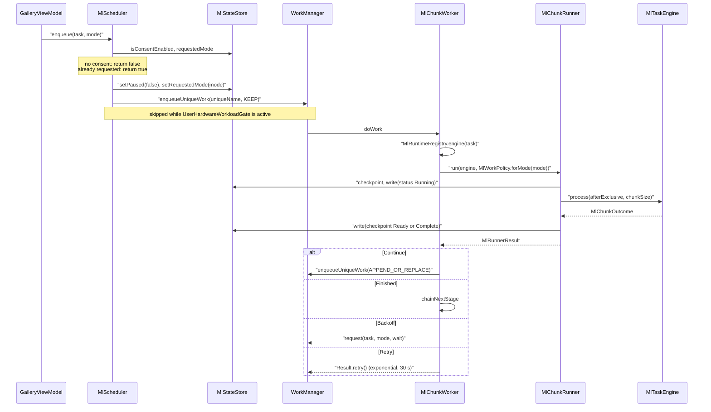
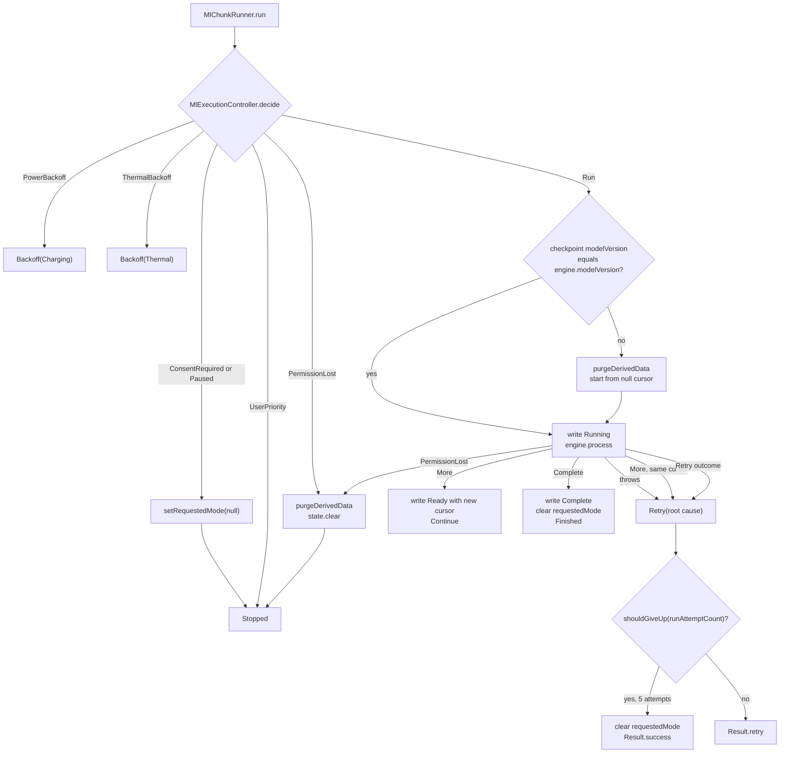
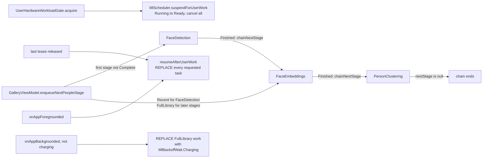
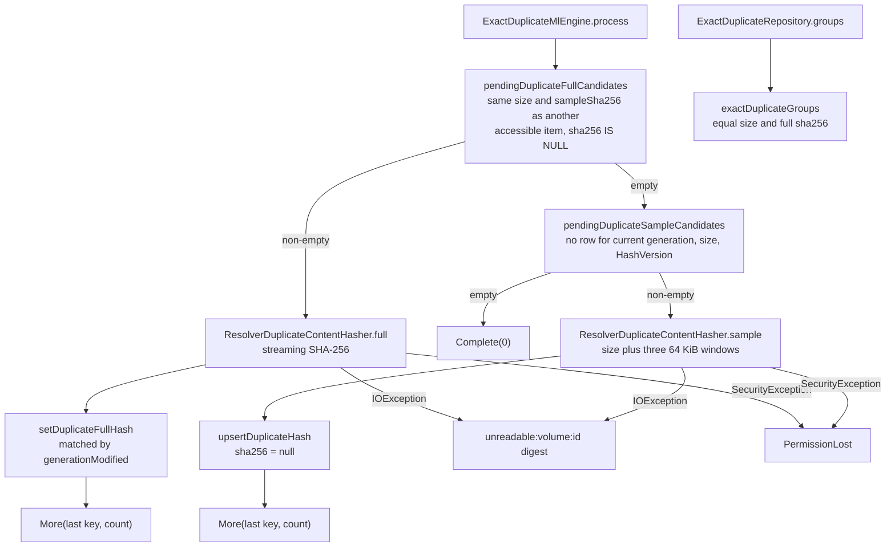

# On-device ML scheduling

Lightforge runs every library-wide analysis task (image labels, OCR, exact duplicates, similarity, face detection, face embeddings and person clustering) as a chain of bounded WorkManager chunks. `MlScheduler` is the opt-in boundary: nothing runs without per-task consent. Each `MlChunkWorker` run processes one chunk through `MlChunkRunner`, which decides whether the task may run now (consent, pause, user workload, media permission, power, heat), calls the task's `MlTaskEngine`, persists a checkpoint in `MlStateStore`, and tells the worker to enqueue the next chunk, wait, retry or stop. Engines write versioned derived rows keyed by MediaStore identity, so replaying a chunk after process death is harmless.

## Where it lives

- [MlTask.kt](../../core/ml/src/main/kotlin/com/librestatic/lightforge/core/ml/MlTask.kt): `MlTaskType`, `MlRunMode`, `MlCheckpoint` (`Status`: `Ready`, `Running`, `Paused`, `Complete`), `MlChunkOutcome`, `MlTaskEngine`, `MlRuntimeRegistry`.
- [MlScheduler.kt](../../core/ml/src/main/kotlin/com/librestatic/lightforge/core/ml/MlScheduler.kt): `MlScheduler.enqueue`, `pause`, `resume`, `restart`, `setConsent`, `deleteDerivedData`, `onAppBackgrounded`, `onAppForegrounded`, `suspendForUserWork`, `resumeAfterUserWork`, `controlState` (`MlControlState`).
- [MlChunkWorker.kt](../../core/ml/src/main/kotlin/com/librestatic/lightforge/core/ml/MlChunkWorker.kt): `MlChunkWorker.doWork`, `chainNextStage`, `nextStage`, `uniqueName` (`lightforge-ml-<task>`), `request`, `shouldGiveUp`, `MaxChunkRunAttempts`, `MlBackoffWait`, `requiringCharging`.
- [MlChunkRunner.kt](../../core/ml/src/main/kotlin/com/librestatic/lightforge/core/ml/MlChunkRunner.kt): `MlChunkRunner.run`, `MlRunnerResult` (`Continue`, `Finished`, `Retry`, `Backoff`, `Stopped`).
- [MlStateStore.kt](../../core/ml/src/main/kotlin/com/librestatic/lightforge/core/ml/MlStateStore.kt): `ml-task-state` shared preferences; `checkpoint`, `write`, `clear`, consent, pause, `requestedMode`, `waitReason`.
- [MlWorkPolicy.kt](../../core/ml/src/main/kotlin/com/librestatic/lightforge/core/ml/MlWorkPolicy.kt): `MlWorkPolicy.forMode` (chunk size and constraints), `MlExecutionController.decide` (`MlExecutionDecision`), `AndroidFullAnalysisEligibility`, `AndroidThermalStatusProvider`, `LocalAnalysisForegroundState`.
- [UserHardwareWorkloadGate.kt](../../core/ml/src/main/kotlin/com/librestatic/lightforge/core/ml/UserHardwareWorkloadGate.kt): `UserHardwareWorkloadGate.acquire`, `release`, `isActive` (`UserHardwareWorkload`: `VideoViewer`, `VideoEditor`, `PhotoEditor`, `VideoExport`).
- [DetectedContentRuntime.kt](../../core/ml/src/main/kotlin/com/librestatic/lightforge/core/ml/DetectedContentRuntime.kt): `DetectedContentRuntime.install` registers a `LazyEngine` per task (called from `LightforgeApplication.onCreate`); purges run without loading a model.
- [ExactDuplicateEngine.kt](../../core/ml/src/main/kotlin/com/librestatic/lightforge/core/ml/ExactDuplicateEngine.kt): `ExactDuplicateMlEngine.process`, `ResolverDuplicateContentHasher.sample` and `full`, `HashVersion`, `ExactDuplicateRepository`.
- [LibraryDao.kt](../../core/database/src/main/kotlin/com/librestatic/lightforge/core/database/LibraryDao.kt): `pendingDuplicateSampleCandidates`, `pendingDuplicateFullCandidates`, `upsertDuplicateHash`, `setDuplicateFullHash`, `exactDuplicateGroups`, `purgeDuplicateHashes`.
- [GalleryViewModel.kt](../../app/src/main/kotlin/com/librestatic/lightforge/GalleryViewModel.kt): `nextPeopleTask`, `enqueueNextPeopleStage`, `monitorPeopleProgress`, foreground/background hooks; [VideoExportQueue.kt](../../app/src/main/kotlin/com/librestatic/lightforge/VideoExportQueue.kt) holds a `VideoExport` lease.

## Enqueue and chunk chain

1. `enqueue` is idempotent: a task that already has a `requestedMode` is not enqueued again, and the unique work uses `ExistingWorkPolicy.KEEP`.
2. Each worker run handles exactly one chunk: 50 items for `Recent`, 100 for `FullLibrary` (`MlWorkPolicy` requires 50..200).
3. After a `Continue`, the worker appends the next one-chunk request to the same unique name and returns success, so progress survives process death through the stored checkpoint, not through a long-running worker.
4. A `Backoff` enqueues a fresh request (resetting `runAttemptCount`): `Charging` adds `requiresCharging`, `Thermal` adds a 2-minute initial delay.

## Chunk decision and outcome

1. `decide` checks, in order: consent, manual pause, `UserHardwareWorkloadGate.isActive`, media permission, then for `FullLibrary` only the power gate (`AndroidFullAnalysisEligibility`: charging, or app in foreground with battery at or above `fullAnalysisMinimumBatteryPercent`), then thermal status at or above `THERMAL_STATUS_MODERATE`.
2. `setWaitReason` records `Charging` or `Thermal` for the UI (`MlControlState.waitReason`) and clears it for every other decision.
3. `UserPriority` stops without clearing `requestedMode`, so `resumeAfterUserWork` can restart the task later.
4. An engine exception rewrites the checkpoint as `Ready` at the old cursor; the worker returns `Result.retry()` until `MaxChunkRunAttempts` (5) is reached, then gives up with success so the chain is not cancelled.

## People stages and lifecycle hooks

1. `MlChunkWorker.nextStage` maps `FaceDetection` to `FaceEmbeddings` and `FaceEmbeddings` to `PersonClustering`; `chainNextStage` enqueues the next stage as `FullLibrary` only when it has consent and is not paused. No other task has an enforced order.
2. `GalleryViewModel.nextPeopleTask` picks the first stage whose checkpoint is not `Complete`; `monitorPeopleProgress` uses it once to recover a chain that stopped between stages.
3. Opening a video, the editors or a video export acquires a lease. The first lease cancels every ML unique work (and semantic indexing via `SemanticAnalysisPriority`) without touching consent, pause, checkpoints or requested modes.
4. Backgrounding while unplugged replaces requested `FullLibrary` work with a charging-constrained request, so plugging in resumes it without opening the app.

## Staged exact-duplicate hashing

1. Each chunk first finishes full hashes for sample collisions, then samples new or changed items. Both queries select pending rows themselves, ordered by `timelineSortMillis`, so the checkpoint cursor is progress bookkeeping and replay re-selects only work that is still pending.
2. `sample` hashes a `lightforge-sample-v1` prefix, the size and the windows at the start, middle and end; `full` streams the whole file in 256 KiB reads. Both check coroutine cancellation between reads.
3. An unreadable file gets a digest no real file can have, so it leaves the pending set without joining a group. A file that changes while hashing makes `setDuplicateFullHash` match zero rows; its new generation is sampled on a later pass.
4. Groups are only exposed for equal size and equal full SHA-256, paged by `DuplicateGroupCursor`.

## Failure and edge cases

- **No registered engine:** `MlChunkWorker` returns `Result.retry()` without consulting `shouldGiveUp`, relying on `DetectedContentRuntime.install` in `LightforgeApplication.onCreate`.
- **Malformed input data:** unknown task or mode returns `Result.failure()`.
- **Permission lost:** before or during a chunk, the engine's derived data and the checkpoint are purged (`PermissionLost`).
- **Model or algorithm version change:** the next run purges derived data and starts over from a null cursor.
- **Cursor did not advance:** treated as `Retry` instead of throwing, because self-selecting engines can race another run.
- **Poison item:** after 5 attempts the chain gives up with success and clears `requestedMode`; `enqueue` or `resume` starts a fresh series.
- **Battery low:** WorkManager's `BatteryNotLow` constraint holds work before the worker runs; `MlScheduler.waitReason` reports this as `Charging` from the sticky battery broadcast.
- **Consent revoked:** `setConsent(false)` cancels the unique work, pauses and clears the request. `deleteDerivedData` awaits the cancellation before `purgeDerivedData`, so an in-flight chunk cannot repopulate rows.
- **Work requested during a user workload:** `enqueue` records the request but does not enqueue; `resumeAfterUserWork` or `onAppForegrounded` starts it.

## Invariants

- One unique work name per task (`lightforge-ml-<task>`); at most one chunk of a task runs at a time.
- No ML request sets a network constraint (`NetworkType.NOT_REQUIRED`); every request requires `BatteryNotLow` and `StorageNotLow`.
- A checkpoint is advanced only after a complete chunk, and engines upsert versioned rows keyed by `(volumeName, mediaStoreId)`.
- Waiting for power or heat never counts toward `MaxChunkRunAttempts`.
- Consent, manual pause, checkpoints and requested modes survive `suspendForUserWork`.
- `MlStateStore` writes with `commit()`, so state is durable before the worker returns.

> ADR-026 was amended on 2026-10-28 to match this behaviour.

> ADR-031 was amended on 2026-10-28 to match this behaviour.

## Related

- [ADR-026: Idempotent local ML scheduling](../adr/ADR-026-idempotent-local-ml-scheduling.md)
- [ADR-027: Staged exact duplicate hashing](../adr/ADR-027-staged-exact-duplicate-hashing.md)
- [ADR-028: Bounded local similarity graph](../adr/ADR-028-bounded-local-similarity-graph.md)
- [ADR-031: Bundled SFace embeddings](../adr/ADR-031-bundled-sface-embeddings.md)
- [ADR-032: Conservative person clustering](../adr/ADR-032-conservative-person-clustering.md)
- [Library sync: MediaStore to Room](library-sync.md)
- [Model packages: download and verification](model-downloads.md)
