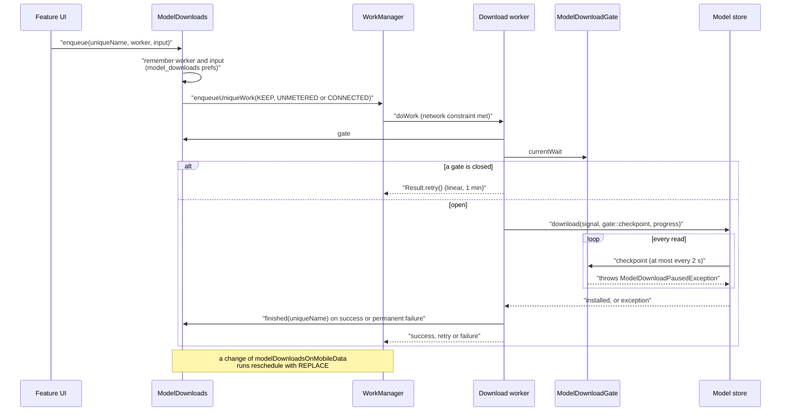
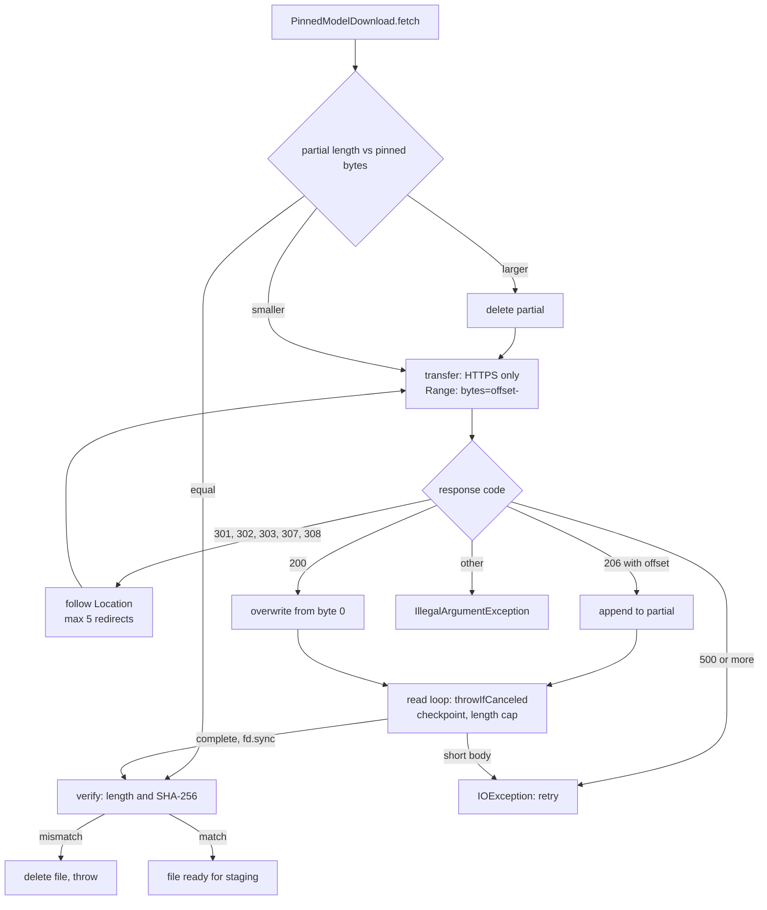
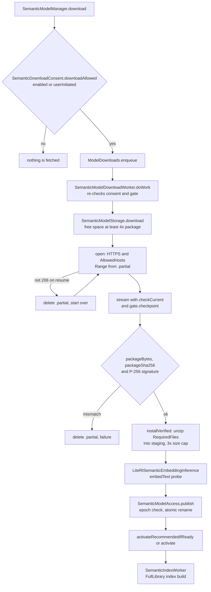

# Model packages: download and verification

Most analysis models are bundled, but three optional features fetch public model files at the user's request: semantic search (signed TinyCLIP packages), pet recognition (a detector and an embedding model) and the object eraser (MI-GAN and a generative inpainting package). All three share one network and battery policy in `ModelDownloads`: a WorkManager worker per package, an `UNMETERED` network constraint unless the user allows mobile data, and a `ModelDownloadGate` checked between reads that pauses the transfer for Wi-Fi, connectivity or battery. Transfers resume with HTTP `Range` requests, every file is checked against a pinned length and SHA-256 before use, and a staging directory is published atomically only after the runtime has loaded the model. Only model bytes are downloaded; nothing about the library is uploaded.

## Where it lives

- [ModelDownloads.kt](../../core/ml/src/main/kotlin/com/librestatic/lightforge/core/ml/ModelDownloads.kt): `ModelDownloads.install`, `enqueue`, `finished`, `reschedule`, `constraints`, `gate`, `currentWait`; `ModelDownloadGate.currentWait` and `checkpoint`; `ModelDownloadWait` (`Network`, `WiFi`, `Battery`); `ModelDownloadPausedException`.
- [PinnedModelDownload.kt](../../core/ml/src/main/kotlin/com/librestatic/lightforge/core/ml/PinnedModelDownload.kt): `PinnedModelFile` (HTTPS URL, byte length, SHA-256), `PinnedModelDownload.fetch` and `verify`.
- [LightforgeApplication.kt](../../app/src/main/kotlin/com/librestatic/lightforge/LightforgeApplication.kt): calls `ModelDownloads.install(this, listOf(PetModelDownloadWorker::updateIfNeeded))`.
- Semantic search, in [feature/semanticsearch](../../feature/semanticsearch/src/main/kotlin/com/librestatic/lightforge/feature/semanticsearch/):
  - [SemanticModelManager.kt](../../feature/semanticsearch/src/main/kotlin/com/librestatic/lightforge/feature/semanticsearch/SemanticModelManager.kt): `download`, `ensureAutomaticDownload`, `cancelDownload`, `activate`, `deleteModel`, `SemanticDownloadConsent`.
  - [SemanticModelDownloadWorker.kt](../../feature/semanticsearch/src/main/kotlin/com/librestatic/lightforge/feature/semanticsearch/SemanticModelDownloadWorker.kt): `doWork`, `uniqueName` (`semantic-model-download-<id>`).
  - [SemanticModelStorage.kt](../../feature/semanticsearch/src/main/kotlin/com/librestatic/lightforge/feature/semanticsearch/SemanticModelStorage.kt): `download`, `installVerified`, `installed`, `SemanticPackageSignature.verify`.
  - [SemanticDownloadCancellation.kt](../../feature/semanticsearch/src/main/kotlin/com/librestatic/lightforge/feature/semanticsearch/SemanticDownloadCancellation.kt): `checkCurrent`, `register`, `cancel`.
  - [SemanticModelAccess.kt](../../feature/semanticsearch/src/main/kotlin/com/librestatic/lightforge/feature/semanticsearch/SemanticModelAccess.kt): `SemanticModelAccess.publish`, `revoke`, `canReplace`; `SemanticIndexCommitGate`.
  - [SemanticModelIntegrity.kt](../../feature/semanticsearch/src/main/kotlin/com/librestatic/lightforge/feature/semanticsearch/SemanticModelIntegrity.kt): per-file `pins`.
  - [SemanticIndexWorker.kt](../../feature/semanticsearch/src/main/kotlin/com/librestatic/lightforge/feature/semanticsearch/SemanticIndexWorker.kt): builds the index after activation.
- Pet recognition, in [feature/petrecognition](../../feature/petrecognition/src/main/kotlin/com/librestatic/lightforge/feature/petrecognition/):
  - [PetModelDownloadWorker.kt](../../feature/petrecognition/src/main/kotlin/com/librestatic/lightforge/feature/petrecognition/PetModelDownloadWorker.kt): `doWork`, `enqueue`, `cancel`, `updateIfNeeded`, `UniqueName` (`pet-model-download`).
  - [PetModelStore.kt](../../feature/petrecognition/src/main/kotlin/com/librestatic/lightforge/feature/petrecognition/PetModelStore.kt): `download`, `importPack`, `installed`, `needsUpdate`, `discardPartialDownload`.
  - [PetModelCatalog.kt](../../feature/petrecognition/src/main/kotlin/com/librestatic/lightforge/feature/petrecognition/PetModelCatalog.kt): pinned URLs, sizes, SHA-256 and `verify`.
- Object eraser, in [feature/objecteraser](../../feature/objecteraser/src/main/kotlin/com/librestatic/lightforge/feature/objecteraser/):
  - [InpaintModelDownloadWorker.kt](../../feature/objecteraser/src/main/kotlin/com/librestatic/lightforge/feature/objecteraser/InpaintModelDownloadWorker.kt): `doWork`, `enqueue`, `cancel`, `status` (`InpaintModelStatus`).
  - [InpaintModelStore.kt](../../feature/objecteraser/src/main/kotlin/com/librestatic/lightforge/feature/objecteraser/InpaintModelStore.kt): `InpaintModelCatalog` (`Migan`, `Generative`), `InpaintModelStore.download`, `openInpainter`; the only caller of `PinnedModelDownload`.
- [AndroidManifest.xml](../../app/src/main/AndroidManifest.xml) and [network_security_config.xml](../../app/src/main/res/xml/network_security_config.xml): `INTERNET`, `ACCESS_NETWORK_STATE`, cleartext disabled.

## Queue, gate and retry

1. `ModelDownloads.enqueue` stores the worker class and input under the unique name, then enqueues with `ExistingWorkPolicy.KEEP` and `constraints(mobileDataAllowed)` (`UNMETERED` or `CONNECTED`, plus `StorageNotLow`).
2. `ModelDownloads.install` collects the mobile-data preference; on a change, `reschedule` re-enqueues every remembered, unfinished download with `REPLACE`. Partial bytes stay on disk and the new request resumes them. It also runs each feature's update check (today only `PetModelDownloadWorker.updateIfNeeded`).
3. `ModelDownloadGate.currentWait` returns `Network` without an internet-capable network, `WiFi` on a metered network when mobile data is not allowed, and `Battery` when unplugged below `fullAnalysisMinimumBatteryPercent` (an unknown level never blocks).
4. Workers map `ModelDownloadPausedException`, `IOException` and (pet, inpaint) `OperationCanceledException` to `Result.retry()`; any other error is a permanent failure and calls `finished`.

## Pinned file transfer

1. `PinnedModelFile` refuses non-HTTPS URLs, non-positive sizes and malformed digests at construction; each redirect target must also be HTTPS.
2. A body longer than the pinned length fails immediately; a short body is an `IOException`, so the worker retries and resumes from the bytes already written.
3. A failed digest deletes the file so the next attempt downloads it again instead of resuming corrupt bytes.
4. `PetModelStore.fetch` is a private copy of the same algorithm (`PetModelCatalog.verify` for the check) and does not call `PinnedModelDownload`; `InpaintModelStore.download` calls `PinnedModelDownload.fetch` for each file.
5. After all files verify, the store loads them in the real runtime (`PetRecognitionEngine` with a probe bitmap, `spec.open` for inpainting) and renames the directory into place, closing open sessions first. `InpaintModelStore.openInpainter` verifies the digests again before every use.

## Semantic package install and activation

1. Automatic downloads (`ensureAutomaticDownload`) need semantic search enabled, local-analysis consent and `Automatic` selection mode. A user-confirmed download (`userInitiated = true`) is allowed even while semantic search is off; the worker re-checks this, so automatic work queued before the user opted out exits as success without touching the network.
2. The download runs on a dedicated executor; `SemanticDownloadCancellation` disconnects the live `HttpURLConnection` when WorkManager stops the worker.
3. Zip entries must be in the `RequiredFiles` allowlist, unique, and inside the staging directory. `complete.marker` holds the package digest; `installed` checks the marker and every file length from `SemanticModelIntegrity.pins`.
4. `publish` fails if a `revoke` (deletion) raised the epoch during installation or if the model is leased by a running inference.
5. `activate` loads the model again, records a pending index and enqueues `SemanticIndexWorker`; the previous index remains searchable until the new one completes.

## Failure and edge cases

- **Wi-Fi lost mid-transfer:** WorkManager stops the worker (network constraint) and the cancellation aborts the blocking read; the gate's `checkpoint` catches the metered and battery cases WorkManager cannot express. Partial bytes are kept.
- **Server ignores `Range`:** the pinned path overwrites from byte 0 on a 200; the semantic path deletes `.partial` and restarts.
- **Corrupt or tampered bytes:** length or digest mismatch deletes the file; semantic packages also need a valid ECDSA signature from the embedded public key.
- **Model fails to load:** staging is deleted and nothing is published; the worker reports a permanent failure.
- **User cancels:** `PetModelDownloadWorker.cancel` and `InpaintModelDownloadWorker.cancel` also discard partial bytes; `SemanticModelManager.cancelDownload` keeps `.partial`.
- **Deletion during install:** pet and semantic installs compare an epoch under a lock and abort if a deletion happened since staging started.
- **Unpublished inpainting package:** `InpaintModelPackage.published` is false while the pinned digest is the all-zero placeholder, so it is not offered.
- **Outdated pet model:** `needsUpdate` (old `recognition.onnx` present) makes `updateIfNeeded` enqueue the new generation under the same policy.
- **Stale preference records:** `reschedule` drops records whose work is finished or whose worker class no longer resolves.
- **Retry has no cap:** download workers never give up on transient errors; they retry with linear 1-minute backoff until success, permanent failure or cancellation.

## Invariants

- Network use starts only from an explicit user action or, for semantic search, from enabled semantic search plus local-analysis consent.
- Downloads use HTTPS only (redirects included) and the app disables cleartext traffic; the semantic downloader also restricts hosts to `AllowedHosts`.
- Every installed file matches a pinned length and SHA-256; semantic packages are also signature-checked.
- Nothing is published until the model has loaded in its runtime; publication is an atomic directory rename with the previous version restored on failure.
- One unique work name per package; all download requests carry the `model-download` tag and the shared constraints.
- Media, thumbnails, queries and embeddings are never sent; only model bytes are received.

> **Note — differs from ADR-013:** the ADR says release manifests "must not contain INTERNET or related network permissions". `app/src/main/AndroidManifest.xml` declares `INTERNET`, `ACCESS_NETWORK_STATE` and `ACCESS_LOCAL_NETWORK` for every flavor, commented as "User-requested signed model downloads and encrypted connections to user-configured storage".

> **Note — differs from ADR-007 and ADR-040:** both say `INTERNET` and `ACCESS_NETWORK_STATE` exist solely for the semantic package downloader. The code also uses them for pet and inpainting model downloads (and the manifest comment adds user-configured storage). Pet and inpainting files are pinned by SHA-256 but not signed.

> **Note — differs from ADR-040:** the ADR describes automatic download "only over validated unmetered Wi-Fi". The code adds a battery gate (`ModelDownloadWait.Battery`) shared with every model download.

> **Note — differs from ADR-039:** the ADR says the ML path requires a bundled model and has no network dependency. The code downloads the MI-GAN and generative inpainting packages through `InpaintModelDownloadWorker`.

> **Note — differs from ADR-041:** the ADR says the pet model is "not bundled" and has "no cloud or network dependency". The code downloads pinned detector and recognition models through `PetModelDownloadWorker`, or imports them as a zip with `PetModelStore.importPack`.

## Related

- [ADR-007: Private model distribution](../adr/ADR-007-offline-model-distribution.md)
- [ADR-013: No Internet release](../adr/ADR-013-no-internet-release.md)
- [ADR-039: Object eraser](../adr/ADR-039-object-eraser.md)
- [ADR-040: Downloadable on-device semantic search](../adr/ADR-040-semantic-search.md)
- [ADR-041: Pet recognition](../adr/ADR-041-pet-recognition.md)
- [On-device ML scheduling](ml-scheduling.md)
