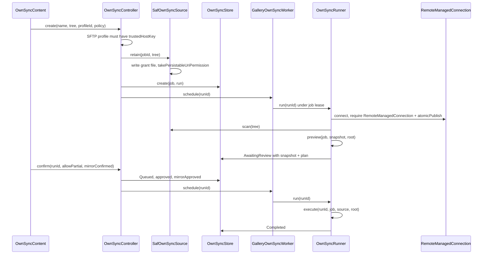
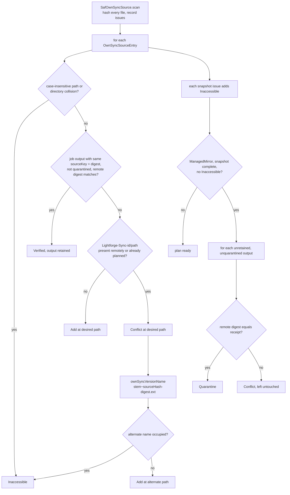
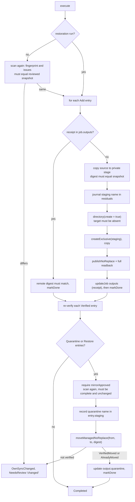
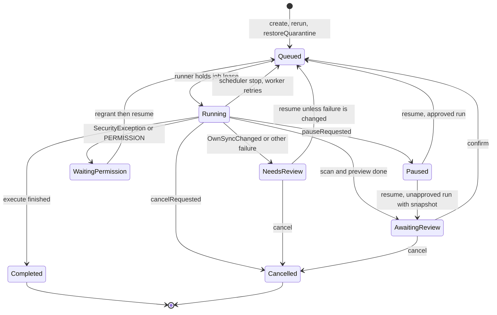

# Folder sync to your own server (OwnSync)

OwnSync copies the files of one local folder, picked as a Storage Access Framework tree, into a namespace directory `Lightforge-Sync-<jobId>` on one of the user's own SFTP or SMB servers. It reuses the server profiles and credential vault of [remote backup](remote-backup.md). An `OwnSyncJob` is the lasting configuration: folder, frozen profile, `OwnSyncPolicy` and the receipts (`outputs`) of every file it has published. Each `OwnSyncRun` scans the folder, builds a plan of `OwnSyncAction` entries for the user to review, and after approval applies it with exclusive creates, verified no-replace publication and reversible quarantine moves. Policy `Additive` only adds. `ManagedMirror` also moves outputs whose source is gone into a quarantine name next to them. Nothing is ever overwritten or permanently deleted on the server.

## Where it lives

- [OwnSyncModels.kt](../../feature/ownsync/src/main/kotlin/com/librestatic/lightforge/feature/ownsync/OwnSyncModels.kt): `OwnSyncPolicy`, `OwnSyncStatus`, `OwnSyncAction`, `OwnSyncSourceEntry`, `OwnSyncSnapshot` (`complete`, `fingerprint`), `OwnSyncOutput` (`quarantine`), `OwnSyncPlanEntry`, `OwnSyncJob` (`namespace`), `OwnSyncRun` (`interruptedStatus`), `ownSyncVersionName`.
- [OwnSyncController.kt](../../feature/ownsync/src/main/kotlin/com/librestatic/lightforge/feature/ownsync/OwnSyncController.kt): `create`, `rerun`, `confirm`, `pause`, `cancel`, `resume`, `regrant`, `restoreQuarantine`, `recoverCancelledMove`, `reconcile`.
- [OwnSyncRunner.kt](../../feature/ownsync/src/main/kotlin/com/librestatic/lightforge/feature/ownsync/OwnSyncRunner.kt): `run`, `needsRetry`, `preview`, `execute`, `remoteDigest`, `remotePresent`, `markDone`, `OwnSyncChanged`.
- [OwnSyncServices.kt](../../feature/ownsync/src/main/kotlin/com/librestatic/lightforge/feature/ownsync/OwnSyncServices.kt): `OwnSyncServices`, `OwnSyncSourcePort` (`retain`, `scan`, `open`).
- [SafOwnSyncSource.kt](../../feature/ownsync/src/main/kotlin/com/librestatic/lightforge/feature/ownsync/SafOwnSyncSource.kt): `SafOwnSyncSource.retain`, `scan`, `open`.
- [OwnSyncIO.kt](../../feature/ownsync/src/main/kotlin/com/librestatic/lightforge/feature/ownsync/OwnSyncIO.kt): `copy` (streaming SHA-256), `MaxFile` (50 GiB), `MaxTotal` (100 GiB).
- [OwnSyncStore.kt](../../feature/ownsync/src/main/kotlin/com/librestatic/lightforge/feature/ownsync/OwnSyncStore.kt): job and run JSON, `lease`, `stage`, `update`, `updateJob`, `changes`, `interrupted`, namespace validation.
- [GalleryOwnSyncWorker.kt](../../app/src/main/kotlin/com/librestatic/lightforge/GalleryOwnSyncWorker.kt): `doWork`, `schedule`, `services` (profiles from `RemoteBackupProfiles.read`), `controller`.
- [RemoteManagedFiles.kt](../../core/remotestorage/src/main/kotlin/com/librestatic/lightforge/core/remotestorage/RemoteManagedFiles.kt): `RemoteManagedConnection` (`directory`, `moveManagedNoReplace`), `RemoteManagedMoveState`, `RemoteManagedMove.verified`.
- [RemoteManagedMoves.kt](../../core/remotestorage/src/main/kotlin/com/librestatic/lightforge/core/remotestorage/RemoteManagedMoves.kt): the SFTP move check (`digest`, `move`). SMB has its own handle-based `moveManagedNoReplace` in [SmbRemoteConnectionFactory.kt](../../core/remotestorage/src/main/kotlin/com/librestatic/lightforge/core/remotestorage/smb/SmbRemoteConnectionFactory.kt).
- [RemoteStorage.kt](../../core/remotestorage/src/main/kotlin/com/librestatic/lightforge/core/remotestorage/RemoteStorage.kt): `RemoteConnection.createExclusive`, `publishNoReplace`, `RemoteCancellation`, `RemoteNames.requireChild`.

## Configuration and run lifecycle

1. `create` requires the profile to exist in `RemoteBackupProfiles`. An SFTP profile must already be pinned with `trustedHostKey`, because OwnSync has no host-key trust step of its own. The job keeps a frozen copy of the profile.
2. `SafOwnSyncSource.retain` writes the tree URI to `own-sync/grants/<jobId>` before it takes a persistable read grant. A later `retain` for the same job must use the identical URI.
3. The first runner pass has `approved = false`. It scans and plans, then stops in `AwaitingReview`. Nothing is written to the server in this pass except the connection's own publication probe.
4. `confirm` refuses an incomplete snapshot or `Inaccessible` entries unless `allowPartial` is set. It refuses a plan that contains `Quarantine` unless `mirrorConfirmed` is set and the snapshot is complete. The second pass runs `execute`.
5. `rerun` starts a new run for an existing job only when the job has no non-terminal run.

## Planning (`preview`)

- The scan visits the tree recursively and hashes every file in full. It checks that the provider-reported size matches the bytes read and that size and mtime did not change while reading. It records anything doubtful as an issue: provider still loading, unreadable or changed file, invalid or duplicate name, depth 64, 20,000 directories, 10,000 files, 100 GiB in total, a cycle. Issues make the snapshot incomplete. They are never taken as evidence that a source was removed.
- A source key is a hash of tree URI, document id and path, so two different sources with identical bytes are still separate outputs.
- Conflicts never overwrite. The newcomer gets the alternate name from `ownSyncVersionName`, and an occupied alternate is not adopted even if its bytes match.

## Applying the plan (`execute`)

1. Each `Add` is staged locally at `stage(runId)` (`source.partial`) and must hash to the reviewed digest. The remote staging name `.lightforge-sync-<runId>-<uuid>.partial` is journaled before `createExclusive`.
2. After `publishNoReplace` the runner reads the file back once more. It then writes the receipt (`OwnSyncOutput`) to the job before it marks the plan entry done. After a crash between the two, the next attempt finds the receipt by entry id and only re-verifies it.
3. An entry that is marked done but has no receipt, or a target that appears after review, raises `OwnSyncChanged`.
4. A quarantine move renames `output.path.last()` to `.lightforge-quarantine-<runId>-<outputId>` in the same directory. A restore moves it back. The intended name is persisted in `entry.staging` before the move. Only `VerifiedMoved` and `AlreadyMoved` count as success. `SourceChanged`, `TargetOccupied`, `ConflictRestored` and `RetainedAmbiguous` stop the run for review and keep all bytes.

## Run status

- `OwnSyncRun.interruptedStatus` decides where an interrupted lease goes. A user cancel goes to `Cancelled`, a user pause to `Paused`, and anything else back to `Queued`. `GalleryOwnSyncWorker` returns `Result.retry()` only when `needsRetry` is true (still `Queued` or `Running` and not paused or cancelled). Waiting for the user is not retried.
- `OwnSyncController.reconcile` runs when the controller is created and on every `onForeground`. It re-schedules non-terminal `Queued` or `Running` runs, and runs with `cancelRequested`, but skips runs marked `corrupt`.
- A run with `failure = "changed"` cannot be resumed. The user cancels it and starts a fresh `rerun`, which scans again.

## Failure and edge cases

- **Folder changed after review**: `execute` scans again and compares `fingerprint` and `issues`. Any difference stops the run before it writes anything. A mirror run scans once more before its moves.
- **Lost grant**: `SecurityException`, or a disallowed network (`networkAllowed`, `ACCESS_LOCAL_NETWORK` on SDK 37 and target 37), sets `WaitingPermission`. `regrant` accepts only the job's identical tree URI.
- **Server file edited by someone else**: a `Verified` output that no longer matches, or a mirror candidate whose digest changed, becomes a `Conflict` or stops the run. It is never quarantined or replaced.
- **Case-insensitive servers**: two sources that differ only by case, or two folders that do, are planned as `Inaccessible` and are not merged.
- **Cancelled during a move**: the move may have reached the server. `recoverCancelledMove` builds a restoration run from the persisted `entry.staging` pair. `restoreQuarantine` puts back any quarantined output on request. Both require that the job has no other non-terminal run.
- **Host key changed or not pinned**: the job's frozen profile cannot be re-trusted from OwnSync. The run ends in `NeedsReview` with `IDENTITY_CHANGED` or `IDENTITY_REQUIRED`.
- **Interruption across processes**: `OwnSyncStore.interrupted` is an in-memory map filled on save. Another process's pause or cancel is picked up on the next lease, through the persisted flags.
- **Leftovers**: staging names and transport `residualNames` stay in `residuals`. The local stage file is deleted when the lease ends.

## Invariants

- Every remote path lies under the job's `namespace`, and every segment passes `RemoteNames.requireChild`. `OwnSyncStore` refuses to save anything else.
- No remote overwrite and no remote deletion. Writes use `createExclusive` and `publishNoReplace`. Removal under `ManagedMirror` is a verified, reversible rename into quarantine, and `Additive` never removes anything.
- A quarantine needs a complete, unchanged snapshot, no `Inaccessible` entries, and explicit `mirrorConfirmed` approval.
- A receipt in `OwnSyncJob.outputs` exists only for a file that was published and read back with a matching `RemoteDigest`.
- At most one run per job executes at a time (the file lock on the job's `lease`).
- Credentials stay in the vault. Sync state holds only the frozen profile metadata.

## Related

- [remote-backup.md](remote-backup.md): profile setup, host-key pinning, the vault and the `core/remotestorage` transports.
- [app-startup.md](app-startup.md): `onForeground`, which calls `OwnSyncController.reconcile`.
- No ADR covers OwnSync. [ADR-046](../adr/ADR-046-optional-all-files-access.md) notes that SFTP/SMB mirroring works through SAF without all-files access, which matches the code.

> [ADR-013](../adr/ADR-013-no-internet-release.md) was amended on 2026-10-28 to match this behaviour.
