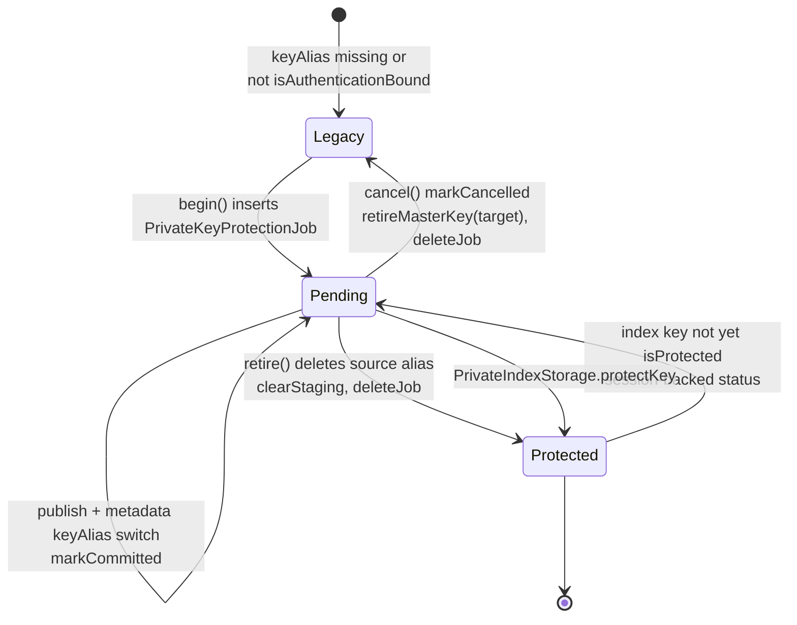
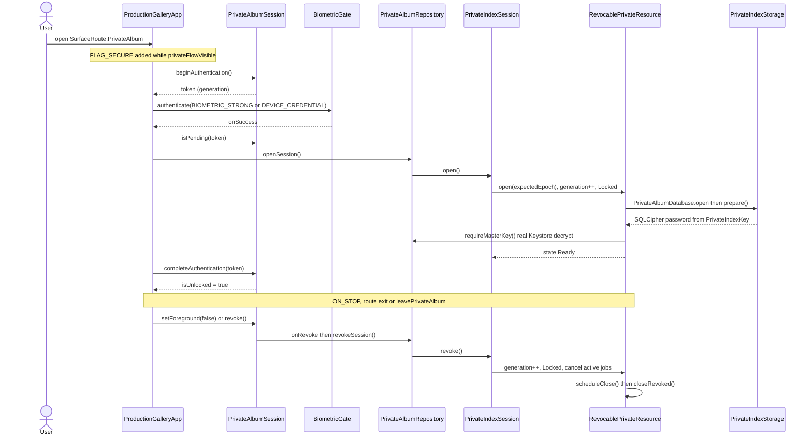
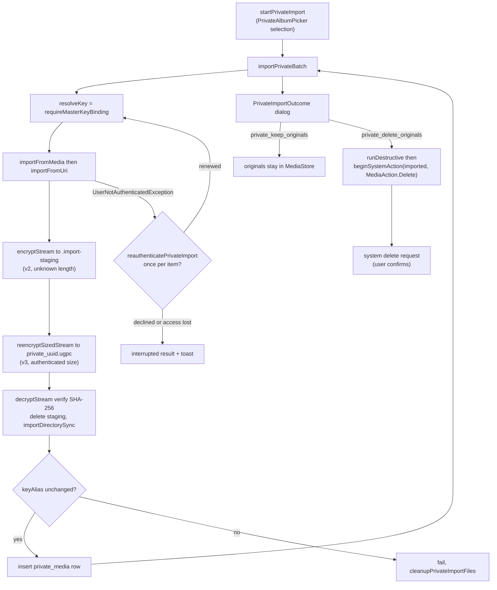
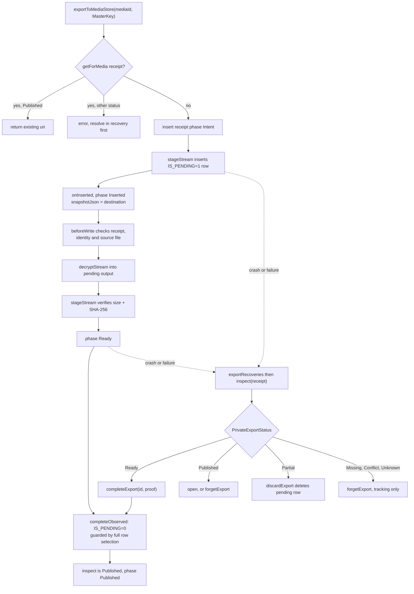

# Private album: keys, unlock and export

The private album keeps photos and videos outside MediaStore and the public library index. Every item is an app-private container (`private-album/private_<uuid>.ugpc`) encrypted with its own AES-256 data key using Tink streaming AEAD (`PrivateAlbumCrypto`). Each data key is wrapped by an Android Keystore master key. That master key needs real user authentication: it is valid for 30 s after a BiometricPrompt that accepts a strong biometric or the device credential. The wrapped keys, the export receipts and the key-protection journal live in a separate SQLCipher Room index (`lightforge-private.db`). The index password is itself wrapped by the authenticated master key. This document covers the resumable migration from a legacy (unauthenticated) master key to an authenticated one, how unlocking opens and later revokes the index session, how items are imported (with optional deletion of the originals), and how an item is exported back to MediaStore with crash recovery.

## Where it lives

- [PrivateAlbumCrypto.kt](../../core/security/src/main/kotlin/com/librestatic/lightforge/core/security/PrivateAlbumCrypto.kt): `PrivateAlbumCrypto` (container magic `UGPC`, `VERSION` 2, `SIZED_VERSION` 3, read-only v1 via `decryptLegacy`), `encryptStream`, `encryptSizedStream`, `reencryptSizedStream`, `decryptStream`, `generateDataKey`, `encryptDataKey`, `decryptDataKey`, `createAuthenticatedMasterKey` (`AUTHENTICATED_MASTER_PREFIX`), `isAuthenticationBound`, `requireExistingMasterKey`, `requiresAuthentication`, `retireMasterKey`.
- [PrivateMasterKeyProtection.kt](../../feature/privatealbum/src/main/kotlin/com/librestatic/lightforge/feature/privatealbum/PrivateMasterKeyProtection.kt): `PrivateKeyProtectionStatus` (`Legacy`, `Pending`, `Protected`), `PrivateMasterKeyProtection.status`, `begin`, `advance`, `cancel`, `finishCancellation`, `retire`, `requireFullDurability`, `PrivateDeviceCredentialRequiredException`.
- [PrivateKeyProtectionDao.kt](../../feature/privatealbum/src/main/kotlin/com/librestatic/lightforge/feature/privatealbum/PrivateKeyProtectionDao.kt): `PrivateKeyProtectionJob` (`private_key_protection`), `PrivateKeyRewrapEntity` (`private_key_rewrap`), `PrivateKeyProtectionDao` (`markInitialized`, `stage`, `pending`, `preparedCount`, `publish`, `markCommitted`, `markCancelled`).
- [PrivateKeyProtectionContent.kt](../../feature/privatealbum/src/main/kotlin/com/librestatic/lightforge/feature/privatealbum/PrivateKeyProtectionContent.kt): `PrivateKeyProtectionPhase` (`Confirmation`, `Working`, `AuthenticationRequired`, `CredentialsRequired`, `Failed`, `Complete`), `PrivateKeyProtectionContent`.
- [PrivateLegacyMigrationPolicy.kt](../../feature/privatealbum/src/main/kotlin/com/librestatic/lightforge/feature/privatealbum/PrivateLegacyMigrationPolicy.kt): `shouldMigrateOnUnlock`.
- [PrivateAlbumContent.kt](../../feature/privatealbum/src/main/kotlin/com/librestatic/lightforge/feature/privatealbum/PrivateAlbumContent.kt): `protectKeys`, `finishProtection`, the index-loading `LaunchedEffect`.
- [PrivateAlbumSession.kt](../../feature/privatealbum/src/main/kotlin/com/librestatic/lightforge/feature/privatealbum/PrivateAlbumSession.kt): `PrivateAlbumSession` (`beginAuthentication`, `completeAuthentication`, `accessToken`, `hasAccess`, `revoke`), `rememberPrivateAlbumSession` (lifecycle `ON_STOP` revokes).
- [PrivateIndexSession.kt](../../feature/privatealbum/src/main/kotlin/com/librestatic/lightforge/feature/privatealbum/PrivateIndexSession.kt): `PrivateDatabaseAccess`, `PrivateIndexSession.open`, `withDatabase`, `revoke`.
- [RevocablePrivateResource.kt](../../feature/privatealbum/src/main/kotlin/com/librestatic/lightforge/feature/privatealbum/RevocablePrivateResource.kt): `PrivateIndexAccessState` (`Locked`, `Ready`, `Unavailable`), `RevocablePrivateResource` (`open`, `use`, `revoke`, `closeRevoked`, `epoch`), `PrivateIndexLockedException`.
- [PrivateIndexStorage.kt](../../feature/privatealbum/src/main/kotlin/com/librestatic/lightforge/feature/privatealbum/PrivateIndexStorage.kt) and [PrivateIndexKey.kt](../../feature/privatealbum/src/main/kotlin/com/librestatic/lightforge/feature/privatealbum/PrivateIndexKey.kt): `PrivateIndexStorage.prepare`, `protectKey`, `PrivateIndexKey.loadOrCreate`, `isProtected`, `protect`.
- [PrivateAlbumDatabase.kt](../../feature/privatealbum/src/main/kotlin/com/librestatic/lightforge/feature/privatealbum/PrivateAlbumDatabase.kt): `PrivateMediaEntity` (`private_media`), `PrivateAlbumMetadataEntity` (`private_album_metadata`), `PrivateAlbumDatabase.open` (`PrivateIndexOpenHelperFactory`).
- [PrivateAlbumRepository.kt](../../feature/privatealbum/src/main/kotlin/com/librestatic/lightforge/feature/privatealbum/PrivateAlbumRepository.kt): `openSession`, `revokeSession`, `requireMasterKeyBinding` (`MasterKey`), `keyProtection`, `importFromMedia`, `importFromUri`, `exportToMediaStore`, `exportRecoveries`, `completeExport`, `discardExport`, `forgetExport`.
- [PrivateImportBatch.kt](../../feature/privatealbum/src/main/kotlin/com/librestatic/lightforge/feature/privatealbum/PrivateImportBatch.kt): `importPrivateBatch`, `PrivateImportBatchResult`.
- [PrivateExportPublication.kt](../../feature/privatealbum/src/main/kotlin/com/librestatic/lightforge/feature/privatealbum/PrivateExportPublication.kt): `PrivateExportStatus` (`Ready`, `Published`, `Partial`, `Missing`, `Conflict`, `Unknown`), `PrivateExportPublication` (`export`, `complete`, `discard`, `forget`, `inspect`), `PrivateExportPolicy`.
- [PrivateExportReceipt.kt](../../feature/privatealbum/src/main/kotlin/com/librestatic/lightforge/feature/privatealbum/PrivateExportReceipt.kt): `PrivateExportReceiptEntity` (`private_export_receipts`), `PrivateExportDao`.
- [PrivateExportRecoveryContent.kt](../../feature/privatealbum/src/main/kotlin/com/librestatic/lightforge/feature/privatealbum/PrivateExportRecoveryContent.kt): the per-status recovery actions.
- [BiometricGate.kt](../../feature/privatealbum/src/main/kotlin/com/librestatic/lightforge/feature/privatealbum/BiometricGate.kt): `BiometricGate.canAuthenticate`, `authenticate` (`BIOMETRIC_STRONG or DEVICE_CREDENTIAL`).
- [PendingMediaWriter.kt](../../core/mediastore/src/main/kotlin/com/librestatic/lightforge/core/mediastore/PendingMediaWriter.kt): `PendingMediaWriter.stageStream`.
- [ProductionGalleryApp.kt](../../app/src/main/kotlin/com/librestatic/lightforge/ProductionGalleryApp.kt): the `SurfaceRoute.PrivateAlbum` unlock callback, `FLAG_SECURE` while `privateFlowVisible`, `leavePrivateAlbum`, `startPrivateImport`, `reauthenticatePrivateImport`, the `PrivateImportOutcome` dialog (`deleteOriginals`).

## Master-key protection journal

`status()` reports `Pending` while a `private_key_protection` row exists. With no row it reports `Protected` when the committed `keyAlias` is authentication-bound, and `Legacy` otherwise. A brand-new vault (no `private_album_metadata`) also starts as `Legacy`, because setting up a vault is this same migration with `sourceAlias = null`. When the repository is session-backed, `status()` also checks the SQLCipher password wrapper. If `PrivateIndexKey.isProtected` is false, it reports `Pending`.

1. **`begin()`** requires `KeyguardManager.isDeviceSecure`, otherwise it throws `PrivateDeviceCredentialRequiredException`. If a job already exists, `begin()` returns it, so it resumes after process death. Otherwise it checks the vault: a populated vault must have `isSetup` metadata, and a new vault must be fully empty (`requireEmptyVault`, no orphan containers). It then inserts the job row before creating any Keystore key. In a second transaction it creates the `lightforge.privatealbum.auth.v1.<uuid>` key (StrongBox if advertised, with a fallback) and sets `initialized`.
2. **`advance()`** first checks `requireFullDurability` (WAL with `synchronous` FULL or stronger). It proves the target key is usable with a real wrap and unwrap. Then it rewraps every pending data key from the source master to the target, verifies each one, and stages it. Batches commit one by one, so an expired 30 s window keeps the progress.
3. **Publication** is a single SQL transaction under `NonCancellable`. It checks that `preparedCount == count` and that nothing is pending. It then rewrites `encryptedDataKey`/`dataKeyIv` (`publish`), points `keyAlias` at the target and sets `committed`. Media containers are never rewritten.
4. **`retire()`** exercises the target key again, deletes the source alias, then deletes the staging rows and the job row. A crash after the alias is deleted resumes from the committed metadata.
5. **Session-backed `advance()`** then runs `PrivateIndexStorage.protectKey`. The unchanged 32-byte SQLCipher password is rewrapped under the authenticated alias (record v2), and the legacy `lightforge.privatealbum.index.v1.*` alias is deleted.
6. **`cancel()`** works only before commit. It records `cancelled`, then `finishCancellation` deletes only the uncommitted target key and the staging rows. After commit, `cancel()` finishes `retire()` instead of rolling back.

The dialog (`PrivateKeyProtectionContent`) only presents this; `PrivateAlbumContent.protectKeys` drives it:

- `Confirmation` → `Working` when the user taps Protect. `protectKeys` always calls `begin()` again, which resumes an existing job.
- `Working` → `Complete` when `finishProtection()` (`advance()`) succeeds.
- `Working` → `AuthenticationRequired` when Keystore throws `UserNotAuthenticatedException` (`requiresAuthentication`), or after `begin()` on the manual path. Continue opens BiometricPrompt and returns to `Working`.
- `Working` → `CredentialsRequired` on `PrivateDeviceCredentialRequiredException`. On any other error it goes to `Failed`. Retry goes back to `Working`.
- Losing the unlock (`isUnlocked = false`) cancels the job and turns `Working` into `AuthenticationRequired`.
- Dismissing the dialog calls `cancel()`. It never resets the album.
- `PrivateLegacyMigrationPolicy.shouldMigrateOnUnlock` starts the same flow automatically, once per unlock, when the index is ready, setup is complete and the status is not `Protected`. Because the user has just authenticated, it first tries without a second prompt. On a device without a screen lock, the automatic attempt hides the dialog.

> ADR-034 was amended on 2026-10-28 to match this behaviour.

## Unlock, session and lock

1. `PrivateAlbumSession` handles UI authorization only. Its state is never saved, and a token from an earlier generation cannot complete a later prompt (`isPending`, `completeAuthentication`). A failed biometric sample (`onFail`) is not terminal. `onError` cancels the pending token.
2. `openSession()` opens a fresh SQLCipher/Room instance every time. `PrivateIndexStorage.prepare` takes a file lock and checks the files. It converts a legacy plaintext index or creates a new encrypted one, then runs `PRAGMA integrity_check` before Room touches anything. The opener calls `requireMasterKey()`, which performs a real `decryptDataKey` (or a wrap and unwrap probe on an empty vault). The state becomes `Ready` only after that succeeds.
3. Every repository call goes through `withDatabase(expectedEpoch)`. The epoch is captured before dispatch, so queued work cannot adopt a later authentication. `MasterKey.sessionEpoch` binds a resolved key to its session.
4. Locking happens on `ON_STOP`, including when an external document picker opens. Leaving the route, `leavePrivateAlbum`, disposal, or an explicit revoke after `UserNotAuthenticatedException` also lock. Each one bumps the generation, closes admission synchronously, invalidates readers and cancels active jobs. The physical close waits on the mutex for admitted atomic work. If closing fails, the state becomes `Unavailable`.
5. `FLAG_SECURE` is set on the window for the whole private flow (`ProductionGalleryApp`) and again in `PrivateMediaViewerContent`. The protection, portable and crop dialogs use `SecureFlagPolicy.SecureOn`.

## Import and optional deletion of originals

- The provider stream is read exactly once. Nothing is written in plaintext: the staging file is already encrypted, and it supplies the measured length for the final sized v3 container.
- The container name is random and leaks nothing about the original. The file is fsynced, then its directory entries, before a Room row can reference it.
- If the import fails or is cancelled, the uncommitted staging file and container are deleted (`cleanupPrivateImportFiles`). A cleanup failure turns into an "Encrypted import cleanup requires retry" result.
- Originals are never deleted as part of the import. Deleting them is a separate user choice in the outcome dialog. It goes through the destructive-action lock (`runDestructive`) and the standard system delete request, and only covers the items that imported successfully.

## Export publication and recovery

1. A receipt (`private_export_receipts`, unique per `mediaId`) is written before any provider insert, and it lives only in the encrypted index. Its `phase` goes through `Intent` → `Inserted` → `Ready` → `Published`. Every update is a compare-and-swap (`requireUnchanged`), and a per-database `Mutex` serializes exports.
2. The output is written under `Pictures/Lightforge/` or `Movies/Lightforge/` as `Lightforge-Private-<uuid>.<ext>`. Plaintext exists only inside the pending MediaStore row, and only after the destination identity has been checked against the receipt snapshot.
3. `inspect` classifies a receipt:
   - `Intent` → `Unknown` (an insert is never adopted by its name).
   - No row → `Missing`.
   - Identity changed, trashed, or `GENERATION_MODIFIED` regressed → `Conflict`.
   - `Inserted`, pending, backing file `ENOENT` → `Partial`.
   - Published and bytes match → `Published`.
   - `Ready`, unchanged and bytes match → `Ready`.
   - Any other pending case → `Partial`. Any unreadable content → `Unknown`.
4. Recovery actions (`PrivateExportRecoveryContent`) need the `proof`, a SHA-256 of the exact observation the user reviewed. If the row changed in the meantime, the action fails with "check again". `discard` is allowed only for `Partial` rows, and deletes the pending row using a selection that matches every field. `forget` removes the receipt only. It never deletes a public file.

## Failure and edge cases

- **Expired 30 s Keystore window:** a key operation throws `UserNotAuthenticatedException`. Import asks again once per item (`reauthenticatePrivateImport`). Export, the viewer and key protection revoke the session or move to `AuthenticationRequired`. The code never creates a new key in response.
- **Missing or invalidated master key:** `requireExistingMasterKey` fails, and the index becomes `Unavailable` or the UI enters `indexUnavailable()`. The vault is never offered as an empty setup or reset. Removing the screen lock can invalidate authenticated keys, so the dialog shows a risk notice.
- **No secure lock screen:** `begin()` throws `PrivateDeviceCredentialRequiredException` (`CredentialsRequired`). `BiometricGate.canAuthenticate` false means the unlock shows `privateBiometricUnavailable`.
- **Process death during migration:** the `private_key_protection` row and the staged wrappers survive. `begin()` and `advance()` resume, and a committed job always finishes `retire()`.
- **Concurrent writer during migration:** an import that commits during staging is picked up by `pending()`. Otherwise the publish check fails with "Private album changed; resume protection". An import that started under the old alias fails its `keyAlias` check.
- **Insufficient durability:** `requireFullDurability` refuses to retire any key unless the database uses WAL with FULL or stronger synchronous commits.
- **Corrupt index:** `PrivateIndexStorage.preserveOnCorruption` rethrows instead of letting SQLite delete the database, and the integrity check fails before Room opens.
- **Export interrupted after the provider commit:** the pending or published row is never deleted on cancellation. It is left for `inspect` and a reviewed recovery action.
- **Re-exporting an item with an unresolved receipt** fails until the receipt reaches `Published` or is forgotten.

## Invariants

- No plaintext media is written to app storage or shared caches. Import staging is encrypted, and export plaintext goes only into the pending MediaStore row.
- Each container has its own data key. Master-key protection rewraps only those data keys and never rewrites a container.
- Key creation always uses a fresh alias. A missing committed or in-progress alias is never regenerated (`createAuthenticatedMasterKey` rejects existing aliases, and `requireExistingMasterKey` never creates one).
- A successful prompt alone never grants access. A real Keystore operation must succeed before the index becomes `Ready`, before protection is reported done, and before the old key is retired.
- Durable intent comes before every irreversible step. The job row is written before the key is created, `committed` before the source key is retired, `cancelled` before the target key is retired, and the export receipt before the MediaStore insert.
- Any loss of foreground or route revokes the session synchronously. No 30 s UI timeout is involved.
- Originals are deleted only by an explicit, separate system delete request, and only for verified imports.

## Related

- [ADR-034: Encrypted private album container](../adr/ADR-034-encrypted-private-album.md): container versions, authenticated master, index wrapper, revocable session. The code differs on automatic migration; see the note above.
- [ADR-010: Private vault cryptography](../adr/ADR-010-private-vault-cryptography.md): chunked authenticated encryption, Keystore hierarchy, BiometricPrompt, copy-verify-delete ordering.
- [ADR-009: Safe media writes](../adr/ADR-009-safe-media-writes.md): pending MediaStore writes. The private export intentionally does not "delete the pending row on any failure". It keeps the row for reviewed recovery (`PendingMediaWriter.stageStream` leaves cleanup to the caller).
- [ADR-022: Restorable system media actions](../adr/ADR-022-restorable-system-media-actions.md): the system delete request used for originals.
- [ADR-024: Bounded share grants](../adr/ADR-024-bounded-share-grants.md): private content cannot enter a share plan.
- Evidence: [private-index-session](../evidence/private-index-session/VERIFICATION.txt), [private-sized-container](../evidence/private-sized-container/VERIFICATION.txt).
- Other flows: [library-sync.md](library-sync.md).
