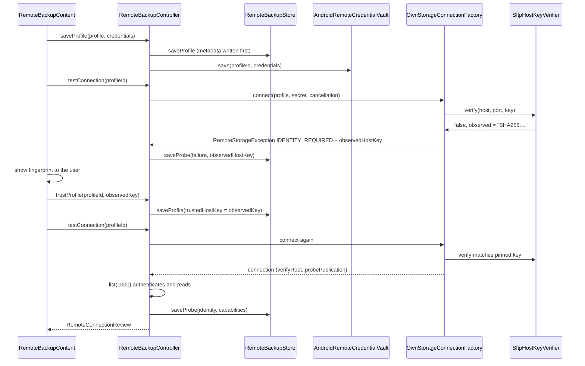
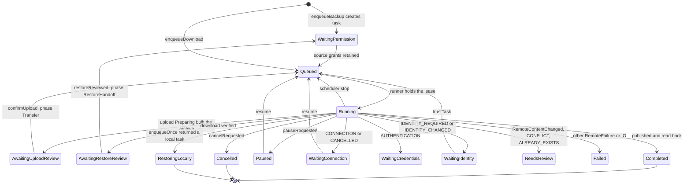
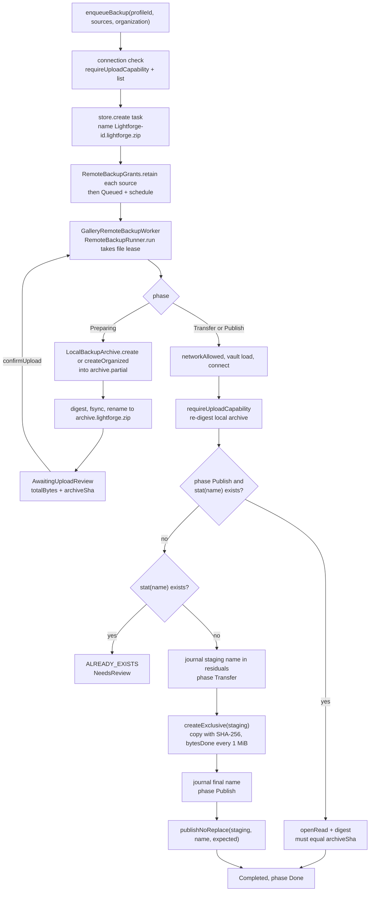
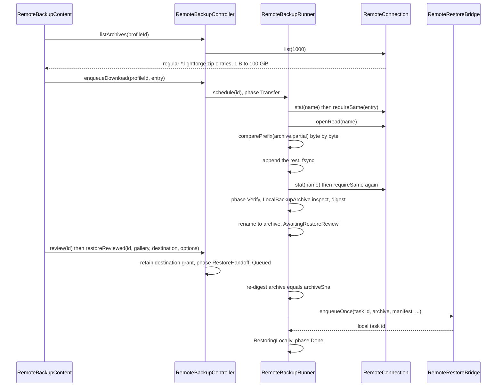

# Backup to your own server (SFTP and SMB)

Remote backup copies a Lightforge backup archive to a server the user controls and brings one back for restore. The user saves a destination (an SFTP or SMB `RemoteProfile`) whose secret goes to an Android Keystore-encrypted vault, pins the SFTP server's host key on first contact, and starts tasks. Each task is one durable JSON record (`RemoteBackupTask`) that moves through `RemoteBackupStatus` and `RemoteBackupPhase` and is executed by `RemoteBackupRunner` inside `GalleryRemoteBackupWorker`, a WorkManager foreground worker. An upload packs the selected `content://` sources into one private archive (`LocalBackupArchive`), so the transfer, verification and publication described below apply to that archive as a whole, not to each photo. A download fetches one `*.lightforge.zip`, verifies it, and hands it to the existing local restore pipeline. Nothing on the server is ever overwritten or deleted.

## Where it lives

- [RemoteBackupModels.kt](../../feature/remotebackup/src/main/kotlin/com/librestatic/lightforge/feature/remotebackup/RemoteBackupModels.kt): `RemoteBackupDirection`, `RemoteBackupStatus`, `RemoteBackupPhase`, `RemoteBackupTask` (`terminal`, `residuals`, `observedHostKey`), `RemoteConnectionReview`, `RemoteProfileProbe`.
- [RemoteBackupController.kt](../../feature/remotebackup/src/main/kotlin/com/librestatic/lightforge/feature/remotebackup/RemoteBackupController.kt): `saveProfile`, `updateCredentials`, `testConnection`, `trustProfile`, `trustTask`, `listArchives`, `enqueueBackup`, `enqueueDownload`, `confirmUpload`, `review`, `restoreReviewed`, `regrantSources`, `regrantDestination`, `pause`, `resume`, `cancel`, `reconcile`, `MaxArchiveBytes`.
- [RemoteBackupRunner.kt](../../feature/remotebackup/src/main/kotlin/com/librestatic/lightforge/feature/remotebackup/RemoteBackupRunner.kt): `run`, the file lease in `leased`, `execute`, `upload`, `download`, `cancelled`, `releaseFinishedGrants`.
- [RemoteBackupIO.kt](../../feature/remotebackup/src/main/kotlin/com/librestatic/lightforge/feature/remotebackup/RemoteBackupIO.kt): `requireUploadCapability`, `digest`, `copy`, `comparePrefix`, `requireSame`, `RemoteContentChanged`.
- [RemoteBackupStore.kt](../../feature/remotebackup/src/main/kotlin/com/librestatic/lightforge/feature/remotebackup/RemoteBackupStore.kt): `profiles.json`, `probes.json`, per-task `task.json`, `archive`, `partial`, `lease`, the `changes` flow.
- [RemoteBackupServices.kt](../../feature/remotebackup/src/main/kotlin/com/librestatic/lightforge/feature/remotebackup/RemoteBackupServices.kt): `RemoteBackupServices`, `RemoteRestoreBridge` (`existing`, `enqueueOnce`).
- [RemoteBackupGrants.kt](../../feature/remotebackup/src/main/kotlin/com/librestatic/lightforge/feature/remotebackup/RemoteBackupGrants.kt): persistable URI grants owned by unfinished tasks.
- [GalleryRemoteBackupWorker.kt](../../app/src/main/kotlin/com/librestatic/lightforge/GalleryRemoteBackupWorker.kt): `GalleryRemoteBackupWorker.doWork`, `schedule`, `services`, `controller`, `ownStorageNetworkAllowed`.
- [RemoteStorage.kt](../../core/remotestorage/src/main/kotlin/com/librestatic/lightforge/core/remotestorage/RemoteStorage.kt): `RemoteProfile` (`validate`, `trustedHostKey`), `RemoteCredentials`, `RemoteCredentialVault`, `RemoteNames`, `RemoteFailure`, `RemoteStorageException`, `RemoteCapabilities`, `RemoteEntry`, `RemoteDigest`, `RemoteConnection` (`list`, `stat`, `openRead`, `createExclusive`, `publishNoReplace`), `RemoteCancellation`.
- [OwnStorageConnectionFactory.kt](../../core/remotestorage/src/main/kotlin/com/librestatic/lightforge/core/remotestorage/OwnStorageConnectionFactory.kt): dispatch by `RemoteProtocol`.
- [SftpRemoteConnectionFactory.kt](../../core/remotestorage/src/main/kotlin/com/librestatic/lightforge/core/remotestorage/sftp/SftpRemoteConnectionFactory.kt): `SftpRemoteConnectionFactory.connect`, `SftpHostKeyVerifier`, `SftpSocketFactory`, `sftpFailure`; [SftpRemoteConnection.kt](../../core/remotestorage/src/main/kotlin/com/librestatic/lightforge/core/remotestorage/sftp/SftpRemoteConnection.kt): `probePublication`, `publishNoReplace`, `hardlink`, `verifyDigest`.
- [SmbRemoteConnectionFactory.kt](../../core/remotestorage/src/main/kotlin/com/librestatic/lightforge/core/remotestorage/smb/SmbRemoteConnectionFactory.kt): `SmbRemoteConnectionFactory.connect`, `SmbRemoteConnection` (`pinRoot`, `publishNoReplace`).
- [AndroidRemoteCredentialVault.kt](../../core/remotestorage/src/main/kotlin/com/librestatic/lightforge/core/remotestorage/AndroidRemoteCredentialVault.kt): AES-GCM key in `AndroidKeyStore`.
- [RemoteRestoreTaskBridge.kt](../../feature/settings/src/main/kotlin/com/librestatic/lightforge/feature/settings/RemoteRestoreTaskBridge.kt) and [LocalBackupArchive.kt](../../feature/settings/src/main/kotlin/com/librestatic/lightforge/feature/settings/LocalBackupArchive.kt): the archive format and the local restore handoff.

## Destination setup and host-key trust

1. `saveProfile` validates the profile (`RemoteProfile.validate`), writes the metadata to `profiles.json` first and then the secret to the vault. A failed vault write leaves a visible profile that asks for credentials. Secrets never enter `profiles.json`, task JSON or UI state.
2. SFTP: `SftpHostKeyVerifier.verify` hashes the server key to `SHA256:<base64>` and accepts it only if it equals `trustedHostKey` (constant-time compare). The verifier runs during key exchange, before any password or key is sent. A missing pin yields `IDENTITY_REQUIRED`, a different key `IDENTITY_CHANGED`; both carry the observed fingerprint, which `connection` stores as a `RemoteProfileProbe`.
3. `trustProfile` only accepts the exact fingerprint recorded in the latest probe for that profile, and only for SFTP. A running task that hits `WaitingIdentity` is trusted separately with `trustTask`, which pins the key into the task's frozen copy of the profile and re-queues it.
4. After authentication the SFTP connection checks the root (`verifyRoot`) and runs `probePublication`. It writes random probe files, checks that exclusive create and `hardlink@openssh.com` refuse to replace, and removes only the probe files it verified. If that passes, `capabilities.atomicPublish` is true.
5. SMB has no host-key pin. `SmbRemoteConnectionFactory.connect` allows only SMB 3.x and requires signing and encryption. It refuses guest or anonymous sessions and DFS shares, resolves paths with `PathResolver.LOCAL` so it does not follow symlinks, and pins the root (`pinRoot`). The connection's `identity` describes the dialect.

## Task status

- `RemoteBackupTask.terminal` is true for `Completed`, `Cancelled` and `RestoringLocally`. The runner returns at once for terminal tasks, for `NeedsReview`, for the two review states and `WaitingIdentity`, and for paused tasks.
- `resume` re-queues anything that is not terminal, not `NeedsReview`, not `WaitingIdentity` and not awaiting review, which covers `Paused`, `Failed`, `WaitingConnection`, `WaitingCredentials` and `WaitingPermission`. A `SecurityException` from a lost URI grant, or a disallowed network, ends in `WaitingPermission`. `regrantSources` and `regrantDestination` accept only the identical URIs and then call `resume`.
- `cancel` sets `cancelRequested`. The runner then marks the task `Cancelled`, unless it was in `RestoreHandoff` and `RemoteRestoreBridge.existing` finds the local child. In that case it becomes `RestoringLocally`.

## Upload: build, transfer, publish

1. `enqueueBackup` requires 1 to `BackupManifest.MAX_ENTRIES` `content://` sources. Before it creates the task, it connects once and requires `encrypted`, `signed` and `atomicPublish`. It creates the task as `WaitingPermission`, retains a persistable grant for each document URI, then queues it and calls `schedule`. `schedule` is `GalleryRemoteBackupWorker.schedule`, which enqueues unique work `remote-backup-task-<id>` with `APPEND_OR_REPLACE`.
2. The worker runs in the foreground (`FOREGROUND_SERVICE_TYPE_DATA_SYNC`). `RemoteBackupRunner.run` takes a `tryLock` on the task's `lease` file. If another runner holds it, `run` returns false and the worker returns `Result.retry()`.
3. Phase `Preparing` is local only. The archive is written to `archive.partial`, then hashed, synced and renamed to `archive.lightforge.zip`. The task stops in `AwaitingUploadReview` so the user can inspect it (`review` re-checks the digest and parses the manifest).
4. `confirmUpload` sets phase `Transfer`. The runner re-hashes the local archive and treats any mismatch as `RemoteContentChanged`. It refuses to start if the final name already exists. Before writing, it journals the random staging name `.lightforge-<taskId>-<uuid>.partial` into `residuals`.
5. `publishNoReplace` is the transport's atomic, verified publication. SFTP verifies the staging digest, hard-links it to the final name and reads the destination back. SMB holds a deny-write handle while it hashes, renames without replace, then checks that the file index and digest match. Staging may stay behind on SFTP and is listed in `residuals`.

## Download and restore handoff

1. `listArchives` lists only regular files ending in `.lightforge.zip` whose size is from 1 byte to `MaxArchiveBytes` (100 GiB). The chosen `RemoteEntry` (name, size, mtime) is frozen into the task.
2. Change detection on the server is `requireSame`. Name, size and `modifiedMillis` must equal the frozen entry both before and after the transfer, or the task goes to `NeedsReview`.
3. Resume does not trust a partial file by its size. `comparePrefix` streams the existing `archive.partial` against the start of the remote file and fails on the first differing byte. The download then appends only the remaining bytes.
4. `restoreReviewed` checks that the request is consistent: a gallery restore needs organization data the review can restore, and a partial organization needs `allowPartial`. It records the target, retains a read/write grant on the destination tree, and queues the task. The runner re-checks the archive digest and calls `enqueueOnce` with the task id as the request id. Repeating it returns the same local task, so a crash cannot create a duplicate restore. From then on the local restore owns the destination grant.

## Failure and edge cases

- **Scheduler stop** (constraints, quota, process death): the watcher closes the sockets through `RemoteCancellation`. A `CancellationException` that the user did not request sets the task back to `Queued`. `RemoteBackupController.reconcile` re-schedules non-terminal `Queued` or `Running` tasks, and those with `cancelRequested`, when the app runtime starts. Tasks whose JSON failed to parse (`failure = "corrupt"`) are skipped.
- **Pause and cancel while running**: the runner watches `RemoteBackupStore.changes` and cancels the token and the coroutine when `pauseRequested` or `cancelRequested` appears. Pause is ignored for terminal tasks and for tasks awaiting review.
- **Upload resumed at `Transfer`**: the runner does not append. Every attempt uses a new staging name, and earlier staging names stay in `residuals`. If the final name exists at `Transfer` (for example, publication succeeded but the response was lost), the result is `ALREADY_EXISTS` and `NeedsReview`. Only phase `Publish` adopts an existing final file, and only if its full digest matches.
- **Uncertain server writes** are journaled before they happen: staging and final names are added to `residuals`, and transport `residualNames` are merged in, up to 1000 entries. Cancelling never deletes anything on the server and keeps the local archive.
- **Network gate**: when `ownStorageRequiresLanPermission` is true (SDK 37 and target 37), `networkAllowed` needs `ACCESS_LOCAL_NETWORK`. Without it the task waits in `WaitingPermission`.
- **Unsupported server**: an SFTP server without `hardlink@openssh.com`, or one that fails the probe, has `atomicPublish = false`, so upload refuses with `UNSUPPORTED` (`Failed`). Restore from that server still works.
- **SMB with private-key auth** is rejected by `RemoteProfile.validate`.
- **Grants**: `releaseFinishedGrants` releases persisted URI grants only for `Completed` and `Cancelled` tasks.

## Invariants

- A task stores a frozen copy of its `RemoteProfile`. Editing the profile later cannot redirect the task's data. A host key is trusted only after the user confirms the exact observed fingerprint.
- No credential, server message or path from an exception reaches persisted state or the UI. Only `RemoteFailure` names and the observed host-key fingerprint do.
- No remote overwrite and no remote deletion. Writes use `createExclusive` and `publishNoReplace`, and every name that might exist is journaled in `residuals` first.
- A task completes only after the destination has been read back in full and matches `RemoteDigest(totalBytes, archiveSha)`. A downloaded archive is digested and inspected before review, and digested again before the restore handoff.
- At most one runner works on a task at a time (the file lock on `lease`).
- An upload needs a transport that is encrypted, signed and supports atomic publication.

## Related

- [library-sync.md](library-sync.md) and [app-startup.md](app-startup.md) (the runtime start that calls `reconcile`).
- [own-sync.md](own-sync.md): folder mirroring that reuses these profiles, the vault and `core/remotestorage`.
- No ADR covers remote backup itself. [ADR-046](../adr/ADR-046-optional-all-files-access.md) notes that backup and SFTP/SMB work through MediaStore and SAF without all-files access.

> **Note — differs from ADR-013:** [ADR-013](../adr/ADR-013-no-internet-release.md) says offline release manifests must not contain `INTERNET`. `app/src/main/AndroidManifest.xml` declares `INTERNET`, `ACCESS_NETWORK_STATE` and `ACCESS_LOCAL_NETWORK` for every flavor, commented as being for model downloads and "encrypted connections to user-configured storage".

> **Note — differs from ADR-040:** [ADR-040](../adr/ADR-040-semantic-search.md) (and [ADR-007](../adr/ADR-007-offline-model-distribution.md)) say `INTERNET` exists solely for semantic model package delivery. Remote backup also uses it to send user-selected media, packed in a backup archive, to the user's own server.
