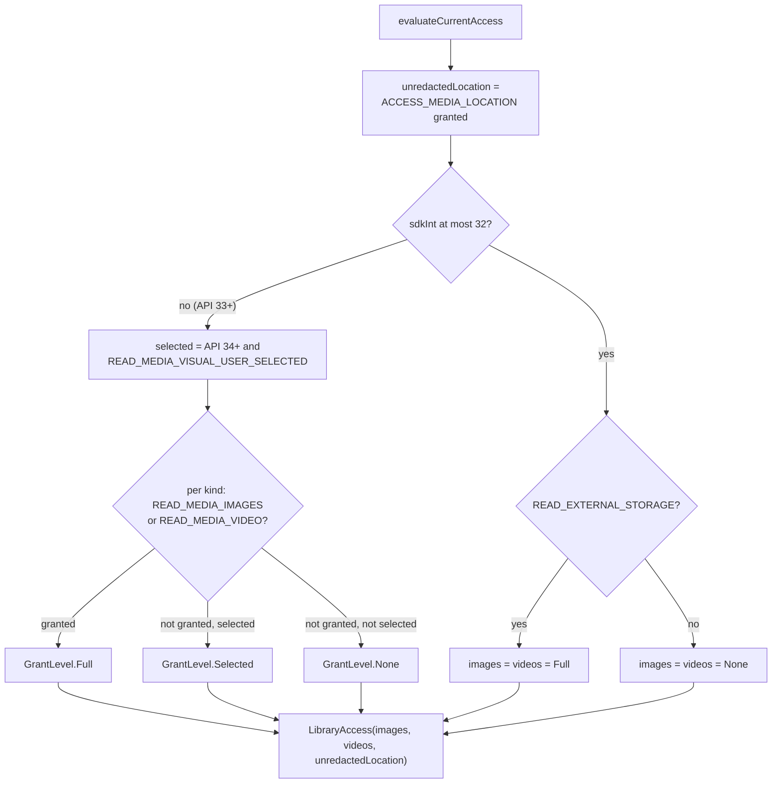
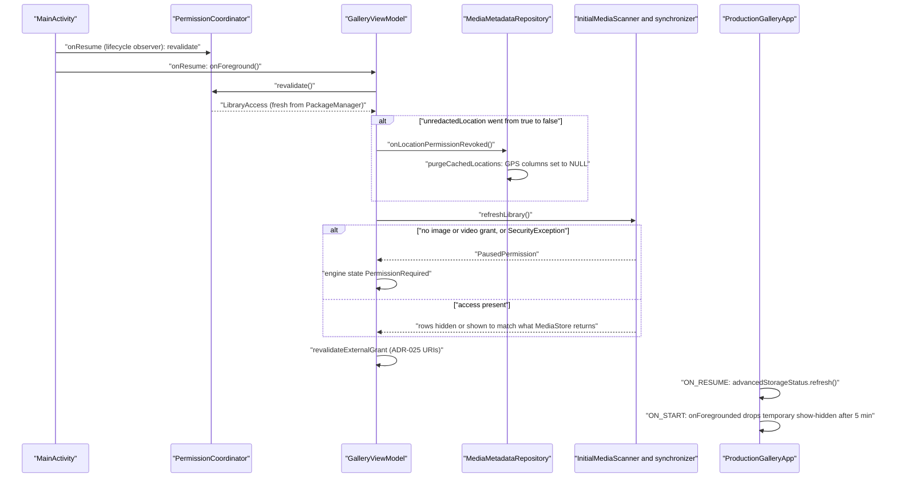
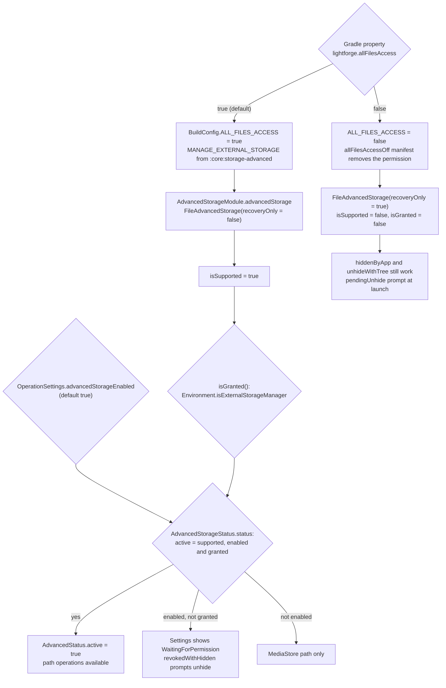
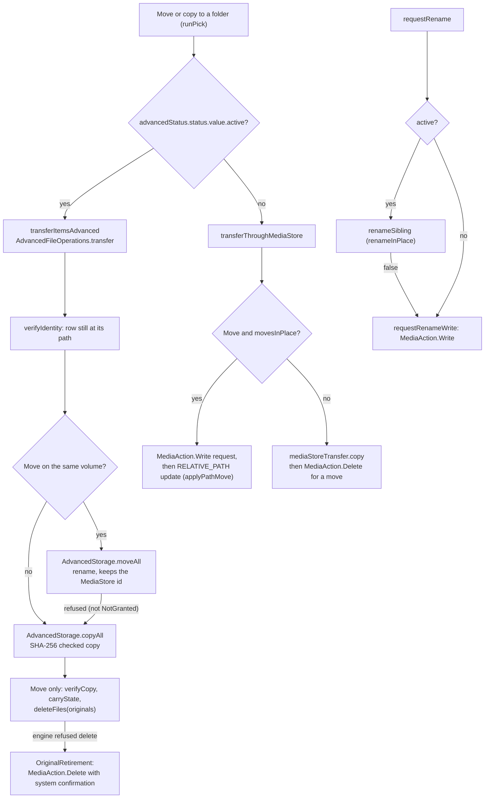

# Storage access: permission states and advanced mode

Lightforge reads shared media only through MediaStore, so what the library can show depends on the runtime media permissions the user granted: full access, a partial "selected photos" grant (Android 14+), or none. `PermissionCoordinator` turns the current grants into a `LibraryAccess` value and recomputes it from `PackageManager` every time the app returns to the foreground; it never persists a grant as truth. Location metadata is a separate grant (`ACCESS_MEDIA_LOCATION`) that decides whether EXIF GPS is read unredacted. On top of this sits the optional advanced storage mode from ADR-046: with All files access (`MANAGE_EXTERNAL_STORAGE`) granted, file moves, renames and folder operations go by path through `:core:storage-advanced`; otherwise every operation stays on the MediaStore path with system confirmation.

## Where it lives

- [PermissionCoordinator.kt](../../feature/permissions/src/main/kotlin/com/librestatic/lightforge/feature/permissions/PermissionCoordinator.kt): `PermissionCoordinator` (`access`, `onResume`, `revalidate`, `initialMediaRequest`, `reselectionRequest`, `locationMetadataRequest`, private `evaluateCurrentAccess`, `mediaGrant`), `PermissionGrantReader`, `PermissionRequestPlan`, `PermissionRequestPurpose`.
- [MediaKey.kt](../../core/model/src/main/kotlin/com/librestatic/lightforge/core/model/MediaKey.kt): `GrantLevel` (`None`, `Selected`, `Full`), `LibraryAccess` (`images`, `videos`, `unredactedLocation`, `isLimited`).
- [MainActivity.kt](../../app/src/main/kotlin/com/librestatic/lightforge/MainActivity.kt): registers the coordinator as a lifecycle observer; `onResume` calls `GalleryViewModel.onForeground`.
- [GalleryViewModel.kt](../../app/src/main/kotlin/com/librestatic/lightforge/GalleryViewModel.kt): `onForeground`, `onPermissionRequestResult`, `refreshLibrary` (sets `LibraryEngineState.PermissionRequired`), `requestRename`, `runPick`, `transferItemsAdvanced`, `transferThroughMediaStore`, `completeTreePick`, `advancedOperations`.
- [ProductionGalleryApp.kt](../../app/src/main/kotlin/com/librestatic/lightforge/ProductionGalleryApp.kt): `requestAccess`, `permissionLauncher`, the lifecycle observer that calls `advancedStorageStatus.refresh`, `onBackgrounded`, `onForegrounded`.
- [MediaMetadataRepository.kt](../../core/data/src/main/kotlin/com/librestatic/lightforge/core/data/MediaMetadataRepository.kt): `exifDetails(key, allowUnredactedLocation)` with `MediaStore.setRequireOriginal`, `onLocationPermissionRevoked` (`purgeCachedLocations`).
- [InitialMediaScanner.kt](../../core/data/src/main/kotlin/com/librestatic/lightforge/core/data/InitialMediaScanner.kt): `canReadAnyMedia`, `ScanState.PausedPermission`.
- [AdvancedStorage.kt](../../core/mediastore/src/main/kotlin/com/librestatic/lightforge/core/mediastore/AdvancedStorage.kt): the `AdvancedStorage` interface (`isSupported`, `isGranted`, `moveAll`, `copyAll`, `deleteFiles`, `renameInPlace`, `hideFolder`, ...), `AdvancedResult`, `NoOpAdvancedStorage`.
- [FileAdvancedStorage.kt](../../core/storage-advanced/src/main/kotlin/com/librestatic/lightforge/core/storageadvanced/FileAdvancedStorage.kt) and [StorageEngine.kt](../../core/storage-advanced/src/main/kotlin/com/librestatic/lightforge/core/storageadvanced/StorageEngine.kt): the implementation; `recoveryOnly`, `Environment.isExternalStorageManager`, path validation (`validated`, `validatedFolder`, `isStandardFolder`).
- [AdvancedStorageModule.kt](../../app/src/main/kotlin/com/librestatic/lightforge/AdvancedStorageModule.kt): the only binding, `FileAdvancedStorage(context, recoveryOnly = !BuildConfig.ALL_FILES_ACCESS)`.
- [AdvancedStorageStatus.kt](../../app/src/main/kotlin/com/librestatic/lightforge/AdvancedStorageStatus.kt): `AdvancedStorageStatus.status` (`AdvancedStatus.active`), `refresh`, `pendingUnhide`, the 5-minute `TemporaryTimeoutMillis`.
- [AdvancedFileOperations.kt](../../app/src/main/kotlin/com/librestatic/lightforge/AdvancedFileOperations.kt): `transfer`, `renameSibling`, `deleteEmptyParents`, `recoverInterrupted`, `OriginalRetirement`.
- [StorageAccessState.kt](../../feature/settings/src/main/kotlin/com/librestatic/lightforge/feature/settings/StorageAccessState.kt): `StorageAccessUiState`, settings-side `AdvancedStatus` (`Off`, `Active`, `WaitingForPermission`), `advancedStatusOf`, `turnOffAction`; [StorageAccessViewModel.kt](../../app/src/main/kotlin/com/librestatic/lightforge/StorageAccessViewModel.kt) fills it.
- Build flag: `lightforge.allFilesAccess` in [app/build.gradle.kts](../../app/build.gradle.kts) (`BuildConfig.ALL_FILES_ACCESS`) and the overlay [app/src/allFilesAccessOff/AndroidManifest.xml](../../app/src/allFilesAccessOff/AndroidManifest.xml).

## Permission levels

1. Images and videos are graded separately on API 33+. `Selected` comes from the API 34 partial grant and only applies to a kind whose full permission is missing. `LibraryAccess.isLimited` is true when either kind is `Selected`.
2. `requestAccess` asks again with `reselectionRequest` on API 34+ when access is limited (the system re-opens the photo picker for the partial grant), otherwise with `initialMediaRequest`. On API 33+ the request includes `READ_MEDIA_VISUAL_USER_SELECTED` from API 34; on API 30 to 32 it is `READ_EXTERNAL_STORAGE`. Onboarding and the picker activity build the same plans.
3. `locationMetadataRequest` asks only for `ACCESS_MEDIA_LOCATION`; the onboarding row reads the result back from `access`.

## Foreground revalidation

1. The coordinator recomputes on every resume. `onPermissionRequestResult` (after the system permission dialog) runs the same `onForeground` with `invalidateViews = true` so the grids reload even when nothing else changed.
2. Losing the location grant clears every cached latitude and longitude in `media_exif_cache`. `exifDetails` opens `MediaStore.setRequireOriginal(uri)` only while `unredactedLocation` is true, and a cached row read without the grant is not reused once it is granted. Moment place labels and the Places source also read `unredactedLocation`.
3. Losing media access does not delete the index. A scan pauses with its cursor kept, and rows MediaStore stops returning (for example after narrowing a selected-photos grant) are hidden with `isAccessible = 0`, not deleted. See [Library sync](library-sync.md).
4. `AdvancedStorageStatus.refresh` re-reads `isGranted()` and the hide registry on every resume, so a revoked All files access takes effect at the next capability check.

## Advanced mode capability

1. The build flag only decides `isSupported`; there is no product flavor. With it off the merged manifest has no `MANAGE_EXTERNAL_STORAGE`, the Settings rows for the mode are absent (`StorageAccessUiState.advancedSupported = false`), and the recovery-only instance still lists folders an earlier build hid so they can be unhidden.
2. `AdvancedStorageStatus.status` is the single capability gate the app reads. Settings derives its three-way label with `advancedStatusOf(enabled, granted)`.
3. `MANAGE_MEDIA` (`MediaManagementAccess`) is independent of this mode: it only removes the confirmation dialogs of the MediaStore path. See [Media actions](media-actions.md).
4. When the mode becomes active, the view model runs `AdvancedFileOperations.recoverInterrupted` (journaled moves) and rescans every folder in `scannedFolders`.

## Choosing the advanced path or the MediaStore path

1. Each entry point checks `advancedStatus.status.value.active` at the moment it runs. Folder operations (create, rename, move, copy, delete, hide) and hide by name exist only with the mode active; the explorer offers them through `selectionCapabilities`.
2. On the advanced path a rename keeps the row's MediaStore id, so favourites, albums and archive state stay attached; row hints re-read the moved rows. A cross-volume move or a refused rename falls back to a verified copy, and the original is deleted by the engine only after `verifyCopy` compares the copy with the item's own content URI. Whatever the engine refuses to delete goes to the system-confirmed delete.
3. On the MediaStore path a same-volume move is one `MediaAction.Write` approval followed by a `RELATIVE_PATH` update; other moves and all copies insert new rows and, for a move, request `MediaAction.Delete` for the originals that arrived. A destination outside the library goes through the system folder picker (`completeTreePick`, `copyToTreeVerified`).
4. Trash, restore, favorite and permanent delete of library items always use the MediaStore action coordinator, with or without the mode. With the mode active, `deleteEmptyParents` may then remove folders left empty when that option is on.

## Failure and edge cases

- **Permission revoked while running:** a `SecurityException` during sync pauses it and sets `LibraryEngineState.PermissionRequired`; the next foreground revalidates and resumes.
- **Selected-photos grant narrowed:** rows MediaStore no longer returns are hidden, not deleted, so favourites and albums return if the user grants them again.
- **Location revoked:** cached GPS is purged at the next foreground; an EXIF read that hits a `SecurityException` never falls back to cached GPS.
- **All files access revoked:** the next `refresh` makes `active` false; operations fall back to the MediaStore path. Folders the app hid stay listed and the page offers to unhide them (owner delete of the app's own `.nomedia`, or a SAF tree grant through `unhideWithTree`).
- **Engine refusals:** paths outside a mounted volume, under `Android/data` or `Android/obb`, the `Android` tree for folder operations, volume roots and standard top-level folders (DCIM, Pictures, ...) are refused with `AdvancedResult.Failed`.
- **`NotGranted` mid-batch:** each item reports it; a move does not fall back to a copy for those items, they count as failed.
- **Process death during an advanced move:** `FileTransferJournal` keeps the in-flight copies; `recoverInterrupted` finishes or drops them when the mode becomes active again.

## Invariants

- Grants are read from `PackageManager` on every foreground; no permission state is stored as truth.
- Losing a grant never deletes Room rows or user decisions; it hides rows or pauses the scan.
- GPS is shown only while `ACCESS_MEDIA_LOCATION` is granted, and cached GPS is cleared when it is lost.
- `AdvancedStatus.active` requires a supported build, the user's opt-in and the system grant; nothing outside `:core:storage-advanced` touches `java.io.File` on shared storage.
- An original is retired on the advanced path only after its copy is byte-compared; the app never records or deletes a `.nomedia` it did not create.
- MediaStore stays the index on both paths: every advanced change is followed by a media scan and row hints.

> **Note:** the `AdvancedStorage` KDoc and the comment above `allFilesAccess` in `app/build.gradle.kts` say the flag-off build binds `NoOpAdvancedStorage`. The code (and ADR-046 section 3) binds `FileAdvancedStorage` with `recoveryOnly = true`; `NoOpAdvancedStorage` has no production binding. Code and ADR agree; only these comments are stale.

## Related

- [ADR-002: MediaStore and Room ownership](../adr/ADR-002-mediastore-room-source-of-truth.md)
- [ADR-011: Minimum SDK 30](../adr/ADR-011-min-sdk-30.md) (the API 30 to 32 branch of the permission matrix)
- [ADR-025: Keep external grants outside library identity](../adr/ADR-025-external-uri-without-library-identity.md) (`revalidateExternalGrant` on foreground)
- [ADR-046: Optional all-files access and media management](../adr/ADR-046-optional-all-files-access.md)
- [Library sync: MediaStore to Room](library-sync.md)
- [Media actions: safe writes, trash and system confirmation](media-actions.md)
